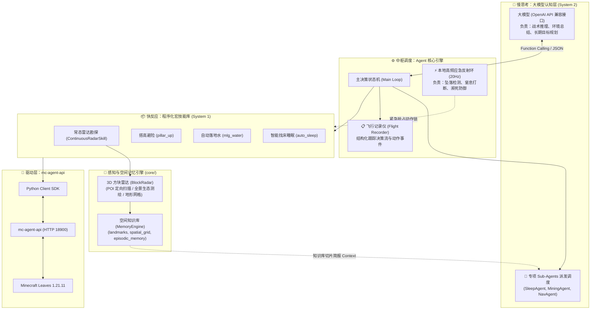

# BotSleep 系统架构设计规范 (ARCHITECTURE)

## 一、设计哲学：慢思考与快反应 (Dual-System Model)

在 Minecraft 这种三维物理沙盒游戏中，AI Agent 面临着严峻的时延与物理反馈挑战。
如果将所有的观察与动作完全交给大模型端到端处理，会产生致命弊端：
1. **网络与推理时延过大**：大模型（如 GPT-4 / DeepSeek / 本地大模型）单次推理耗时通常在 0.5s ~ 2.5s 之间，而 Minecraft 游戏以 20 TPS（每刻 50ms）运转。
2. **硬实时动作易暴毙**：类似“自动落地水 (MLG Clutch)”、“跳跃躲避伤害”这类操作要求在 1~3 个游戏刻（50~150ms）内完成，必须由本地程序化状态机直接响应。

因此，**BotSleep 采用“双脑分层决策系统”**：

---

## 二、系统核心分层规范

### 1. 认知层与 Sub-Agent 派发 (Cognitive & Sub-Agents - `agent/`)
- **主决策脑**：负责大局规划，判断当前生存状态（白天外出搜集资源、夜晚避险找床）。
- **Sub-Agent 简报切片调度**：
  - 当主决策脑需要派发专业子任务（如 `sleep_agent` 或 `miner_agent`）时，**不全量下发整个世界数据**；
  - 由 `MemoryEngine.get_subagent_context(task_type, pos)` 精准提取专属知识包（如：仅向挖矿 Agent 下发附近 48 格的矿石坐标与工作台位置）。

### 2. 3D 方块雷达与空间知识库 (`core/radar.py`, `core/memory.py`)
- **不计性能比赛的信息完整捕获原则**：
  - 维持对视距内方块的高频全量扫描；
  - 自动归类五大战略 POI：床 (`bed`)、功能工作台 (`crafting`)、存储箱 (`container`)、矿石资源 (`mineral`)、危险/液体 (`liquid_and_hazard`)；
  - 结构化落盘至 `data/game_logic/`：
    - `landmarks.json`：持久化兴趣点数据库。
    - `spatial_grid.json`：记录已探索的区块坐标与行动航迹。
    - `episodic_memory.jsonl`：全时序回忆日志。

### 3. 常态化自动化技能 (`skills/exploration.py`)
- `ContinuousRadarSkill`：可开关的常态巡航技能。
- 采用位移距离触发机制（当角色移动累计超过阈值如 6 格时，自动向周围发射雷达扫描并刷新持久化记忆）。

### 4. 调度与反射层 (`core/telemetry.py`)
- 20Hz 独立后台守护线程，对致命下落、岩浆浸入做硬实时响应。

---

## 三、协作开发与分支规范

为保障多人协作与版本隔离：
- **主分支 (`main`)**：保持纯净且可稳定部署的代码基准。
- **个人工作分支 (`develop-tianya`)**：用于 TianYa 的个人功能开发、测试与阶段性提交。
- **存档隔离原则**：Minecraft 运行世界（`world/`）与庞大二进制必须物理隔绝在 `minecraft-server/` 文件夹中，严禁推送到 Git 仓库。
