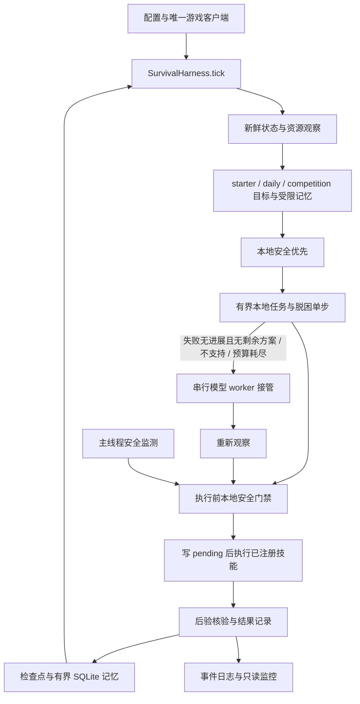

# BotSleep 架构与实现状态

更新：2026-11-16。源码核对基线：`38db5d5` 加阶段候选投影与本地执行优先等工作树改动；最终离线结果见 [TESTING.md](TESTING.md) 首节，尚未实服验收。本页描述拉取后的实际运行路径；未来赛事接口和已确认产品方向见 [HARNESS_INTERFACES.md](HARNESS_INTERFACES.md)。验证结果见 [TESTING.md](TESTING.md)，不要把设计图或历史实服状态当作当前验收。

## 1. 当前入口与运行模式

`main.py` → `core/config.py` 加载默认值、YAML、环境变量及命令行覆盖，创建一个配置作用域内的游戏客户端。`bot_sleep.py` 与根 `client.py` 是兼容转发，不是第二套实现。普通依赖为 `requirements.txt` 中的 requests/PyYAML；RCON 只用于可选开发测试，主循环不依赖它。

| 模式 | 控制器/规划器 | 完成与退出 |
|---|---|---|
| sleep（默认） | `SleepController` + 睡眠技能 | 夜间/雷暴找床、验证入睡及醒来；可取消，有超时 |
| survival/starter | `SurvivalHarness` + 规则或 `LLMSurvivalPlanner` | 根据当前物品/工作站核验初期石器目标；受步骤/时间/死亡预算限制 |
| survival/daily | 同一 harness + 日常任务板和本地策略 | 13 项任务动态重算，33 个注册模型工具；持续维护，无 starter 的最终 goal_complete |
| survival/competition | 同一 harness + `CompetitionTasks`、服务器 advancement 和 LLM | 125 项规则目录（120 个目标、5 个根节点）；本地优先推进已支持 scored 目标、耗尽后模型接管，只有 fresh 服务器证据计分；所有目标检测后才可正常结束 |

开启模型需 `agent.mode: survival` 且 `llm.enabled: true`。`--check-config` 只检查配置，不连接服务。`.env` 不由主程序自动加载。主入口退出会关闭控制器、等待工作线程清理并登出；这不是设计中“模型对话 handoff 保持游戏会话”的实现。

## 2. 当前执行链

`DailySurvivalGoals`、`CompetitionTasks` 是本地任务组件，不是模型 subagent；当前无图中“多专项模型派发”一类运行时。主循环也没有把传送门、整树伐木或独立配方规划器接入模型分派。

另有开发路径：`--debug --radar` 创建 `ContinuousRadarSkill` 并开启 daemon 线程，读取客户端、将 POI/航迹写入 `MemoryEngine`。单独 `--radar` 不创建该对象。门户浇筑、独立合成与伐木需由程序显式调用；聊天的 `chop_skill`、`craft_skill` 注入槽在 `main.py` 尚未赋值。它们不继承生存 harness 的动作互斥、pending 和取消恢复保证。

本地结果直接记录；只有模型提案按原生 call_id 配对工具反馈。模型接管时每轮只提一个已注册的工具，程序验证参数与执行前状态，再派发有限技能或最多 8 步的小批任务。模型文本自报“完成”、API 返回 ok 或路径目标点存在，均不能替代技能的实际效果核验。

启用模型的路径默认先走 `LocalExecutor`；未启用模型仍用原规则规划。配置 `survival.local_execution` 默认 enabled=true、max_steps=64、max_seconds=180（秒），上限128步/600秒，设 enabled=false 可关闭本地执行优先。本地规划只返回当前一步，不直接访问游戏；每步新观察，经原安全检查、pending 和单动作执行线程，再核验真实结果。失败/无进展签名会跳过，位置另写内部 `context.local_execution.failed_targets`，下一轮规划合入受阻目标，优先换其他已观察且安全的资源目标；无剩余可用方案、无支持计划或预算耗尽后交模型，不因 provider 出错才启用。

已登记且新鲜核验仍在加工的熔炉任务由本地等待与重观测推进；等待仍消耗本地步骤/时间预算，槽位未知、输出不匹配或预算耗尽才交模型。

树冠身体高度清叶仍与模型共享 `canopy_clearances(...)` 候选；无近敌的安静树冠优先使用本地专用 `plan_canopy_step` / `descend_canopy` 分段下降，侧下方清叶不扩展为模型权限，不保证脱困。接管只附最近最多6条动作的 success/error_code/progress 摘要。未知动作保留 pending，模型槽非 idle 时不本地生产。7个赛事行动计划及9/33/38模型工具目录保持原范围。

`main.py` 按 `SurvivalHarness.next_poll_seconds` 唤醒：busy 或无退避的本地ready最多等待50ms，成功的本地中间步骤 delay=0，不再插入普通poll等待；每步仍重新观察并串行执行。失败退避、暂停和终态保持原策略。聊天用 `next_debug_poll` 按原配置间隔单独节流，快tick不放大聊天API请求，也不等于20Hz实时反射。

## 3. 模块职责

| 模块 | 已有职责 |
|---|---|
| `core/client.py` | 统一端点、认证、HTTP/业务错误与超时；保留原响应封装，列表型方法做结构转换 |
| `core/radar.py` | 3D 方块全景雷达测绘与关键 POI 定向扫描 |
| `core/recipes.py`、`data/recipes.json` | 886 个可合成产物的配方目录及前置解析；独立 `CraftItemSkill` 使用，不替换模型 `craft_item` |
| `skills/portal_speedrun.py` | 独立分步浇筑、点火与门框读取；坐标和阶段由调用者提供，未绑定模型工具 |
| `skills/portal_telemetry.py`、`skills/lava_lake_generator.py` | 前者主动读取门户动作前后状态并导出 JSON，后者通过 RCON 生成专用测试地形；不是只读 EventMonitor |
| `skills/crafting.py` | 智能 2x2/3x3 工作台调度合成与工作台自动回收 |
| `skills/mining.py` | 整树连续自动伐木与掉落物拾取 |
| `skills/exploration.py` | 可开关后台雷达，约每秒读取状态，默认位移 6 格后扫描；不是寻路或导航执行器 |
| `skills/daily_survival.py` | 日常生存技能库（作物、狩猎、铁矿、装备、熔炼、储物、床门、5x5 庇护所） |
| `core/local_execution.py`、`core/local_tasks.py`、`core/local_recovery.py` | 本地单步规划、预算/失败证据/接管摘要、共享清叶候选与本地树冠下降绑定；沿用串行执行链 |
| `core/canopy_geometry.py`、`skills/canopy.py` | 四正方向有界下降规划；`CanopyRecoverySkill` 执行 harness 内部 `descend_canopy(pos, clear_pos, expected_name)`，不增加模型工具 |
| `core/survival_harness.py` | 串行任务推进、单游戏动作线程、独立模型 worker、安全复查、取消、失败退避和检查点 |
| `agent/llm_planner.py`、`agent/tools.py` | 按 objective 暴露 starter 9 / daily 33 / competition 38 工具；严格解析原生 tool call，保留配对工具反馈 |
| `core/competition_rules.py`、`core/competition_tasks.py` | 读取规则目录、计算可用性和服务器 advancement 证据、管理选择/完成/强退/终止及得分；不执行游戏动作 |
| `core/model_worker.py`、`core/model_gate.py` | 慢模型异步等待；同服务/凭据作用域的本机线程与进程门禁；未知请求持久化锁定 |
| `core/survival_state.py` | 有界观察与原子检查点，按 API/账号/world_id 隔离；pending 不自动重放 |
| `agent/daily_survival.py` | 根据当前证据生成日常任务板、依赖、缺口和建议；competition 中仅作生存辅助，不是计分来源 |
| `core/daily_observation.py`、`core/daily_policy.py` | 日常证据采集、安全情境和模型放行条件；未知资源不当成可执行目标 |
| `skills/survival.py`、`skills/daily_survival.py` 等 | 采集、制作、移动、撤退、农业、熔炼、住所、容器等执行及后验验证 |
| `core/survival_memory.py` | 有界 SQLite 事件、地点和失败策略记忆；召回候选仍须重新观察 |
| `debug/` | 白名单聊天调试、脱敏日志、本机只读监控；不是人工比赛控制方案 |
| `integrations/ninjabrain/` | 独立末影之眼采样和官方计算核心；未绑定 starter/daily 模型目录 |

旧 `agent/loop.py` 和 `core/telemetry.py.ReflexDaemon` 仍有 TODO，但不是当前生存主循环。`core/memory.py` 与 `data/game_logic/` 现被开发雷达/独立伐木复用，但不是当前生存检查点或 SQLite 记忆。默认数据目录不按 API/账号/world_id 隔离，其中部分文件受版本控制，调试后须检查 diff。维护时不要据旧骨架推断整个系统未实现。

`snapshot.local_execution` 的摘要由 EventMonitor 投影，HTML 卡片显示本地阶段、步数、原因与最近最多6条动作；当前决策来源只读 `DECISION.data.source`（local/model/manual/safety/rules），缺失显示未确认，不据 planner 推断。

## 4. 模型请求与游戏动作的两套未知状态

**模型侧**：`ModelRequestGate` 在进程内/本机跨进程串行化请求。安全事件可取消旧模型提案的消费，但不能证明远端生成已结束；worker 等请求返回后排空，不执行过期提案。传输超时/连接中断留下 `uncertain`，重启不会自动放行。只有确认 provider 无在途请求后才可 `--acknowledge-model-idle`；不能用此参数试探解锁。明确 HTTP 错误按当前策略处理，模型失败不回退为规则采集。

**游戏侧**：动作前写 pending，结果不明则保存并暂停；`--resume` 重新观察后规划，不重发旧动作。不能用它解除模型请求未知状态。`stop` 是停止请求，不是服务器已释放动作锁的保证；本地取消也不能立即杀掉同步 HTTP。主进程退出可能等待请求超时，运行预算不是进程强杀期限。

两者都不是“失败即可重试”。同一机器人之外的外部进程控制权，以及通用分布式动作调度，尚未由当前实现全面解决。

## 5. 上下文、进度与记忆

模型接管时发送精简观察、目标板、受限记忆、`context.local_execution`（phase/reason/steps/最近最多6条结果）和最近完整原生工具事务；competition 的 `model_view()` 只提供当前状态解锁的候选摘要，选中后仅展开活动任务完整说明，125 项全目录仍由本地检测与监控使用。按历史轮数和请求 JSON 字节预算裁剪。starter 默认上限 30,000 字节，daily 48,000 字节（含工具定义），不是 provider 的 token 窗口。模型当前/历史消息使用紧凑 JSON 减少空白，但仍按 HTTP JSON 的实际 ASCII 转义表示计费预算。最近未交付工具结果受保护；当前输入本身过大则报 `llm_context_limit`，不发送请求。

这不是访谈确定的 Pi/OMP token-aware、模型语义摘要与持久化边界的自动 compact；显式 handoff、动态 SKILL.md 加载、重复输出→compact→force-exit 的完整机制也尚未实现。已有重复失败/目标冷却不应命名为完整 attention-collapse 检测。

当前 `SurvivalJournal` 保存 context/pending/last_result，并把 competition 状态按 API/账号/world_id 保存；终态重启后保持退出，非终态恢复仍需新鲜观察，pending 不自动重放。SQLite 记忆另有容量/召回预算。模型历史未作为跨进程对话自动恢复协议持久化。

## 6. 安全与导航边界

已有安全监测能识别近敌、生命、火/岩浆、水中和死亡等变化，取消过期模型提案或请求停止动作；日常策略可选择进食、睡眠、撤退和短安全观察。daily/competition 无床、无已验证庇护路线时，可在满血、食物充足、无近敌和稳定落地等条件下进入 night_preparation：本地或模型只做3格内单步准备，禁止批量/探索/狩猎；执行前门禁与在途伤害/威胁缓冲监测一致，参见 [DAILY_SURVIVAL.md](DAILY_SURVIVAL.md)。现场安全可能只能返回 unsafe/等待，不能宣称一定脱困。

现有移动/撤退技能有局部几何、支撑、净空、危险地形及位置后验检查；树冠分段撤退、清叶和失败状态更新有离线测试。**通用水面优先导航、Baritone 式局部搜索、surface_swim 和跨虚空/岩浆自动搭路尚未实现。** 普通 move_to 不保证浮水；旧设计的 20Hz 硬实时反射、自动搭高和落地水也不在当前能力中。

树冠新路径修复的是局部恢复遗漏：用户新运行仍在 `posY=92`、`no_verified_local_recovery`、0 steps，身体高度叶片已清而附近地面脚部 Y 为88。旧清叶只覆盖身体高度，完整 retreat 还受历史 threat 方向和实心终点约束。新增规划要求居中站在脚下干叶上，四正方向最多3格内找降低1～2格的落脚点，可先水平1格朝已核验下降口推进；最多清一格侧下方叶片，绝不挖自身支撑，不盲目 wander。daily collector 仅在 `canopy_blocked` 且无显式危险时采样，预算最多96次方块读/3秒。

harness 本地专用 `descend_canopy` 沿用串行 pending，写前重读12格实体门禁和支撑/身体净空；最多一次 `dig(collect=False)` 加一次 `move_to(range=0)`，精确确认落地。未知 dig 禁止 move 和重放。仅安静、无近敌树冠使用新路径并忽略历史威胁方向；近敌旧 retreat 保留。实心地面清恢复，叶片继续重观测；四格直落仍拒绝。generic clear/force 仍保持身体高度限制，工具9/33/38不变。

用户已确认的未来导航方向仍是：harness 全权规划、安全水面优先、不潜没时不计氧气、必要时按资源预算搭路；下意识行为可消耗资源应急，核验后续接原任务意图。实现前必须处理观察覆盖不足和动作互斥，不借用相邻 API 补丁。

## 7. 验证与下一步

完整 starter 链路离线验证通过，含采集扣材料、工作台放置、三件石工具与熔炉、goal_complete，零模型请求。本轮最终结果以 [TESTING.md](TESTING.md) 首节为准；未做实服验收，不能据离线结果宣布自然地图完整生存成功。

离线覆盖包括模拟 `92→91→90→88` 到 ground、零模型请求、competition selection 先恢复、未知 pending、内部动作非模型工具、规划预算与失败目标排除。最终离线结果见 [TESTING.md](TESTING.md) 首节，尚未实服验收。侧叶用例不是实服验收，不承诺任意树冠成功。本轮未重启或操控在线机器人，现场仅读日志和监控，当前进程需重启加载修改。

后续先复用现有配置、客户端、模型门禁、后验验证和检查点机制，再补语义 compact/handoff、阶段 skill 加载与水面/搭路导航执行器；competition 任务选择和退出的基础闭环已实现。不要并行新建第二套无人维护的调度/认证体系；未来接口名见 [HARNESS_INTERFACES.md](HARNESS_INTERFACES.md)，未实现入口不得广告给模型。

## 8. 协作开发与分支规范

为保障多人协作与版本隔离：

- **主分支 (`main`)**：保持纯净且可稳定部署的代码基准。
- **个人工作分支 (`develop-tianya`)**：用于 TianYa 的个人功能开发、测试与阶段性提交。
- **存档隔离原则**：Minecraft 运行世界（`world/`）与庞大二进制必须物理隔绝在独立服务端，严禁推送到 Git 仓库。
- **密钥安全**：本地配置文件（`config.yaml`）已配置 `.gitignore` 绝不入库，示例见 `config.example.yaml`。
