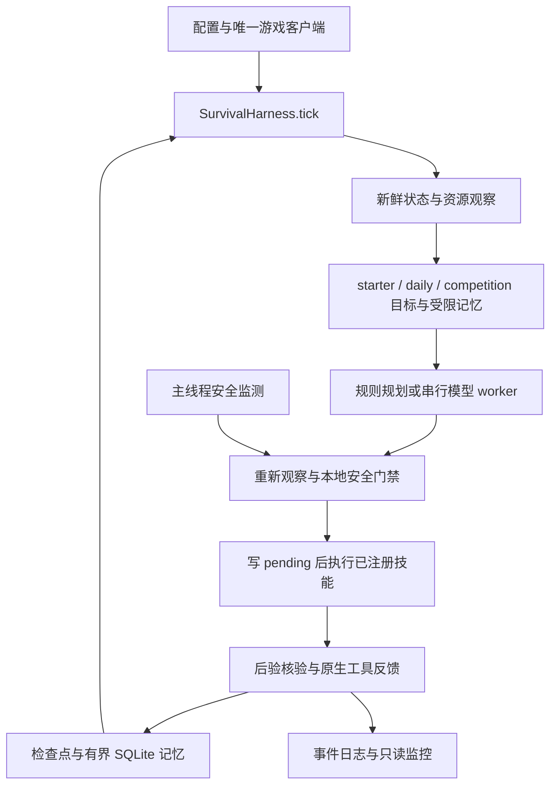

# BotSleep 架构与实现状态

更新：2026-11-16。本页描述当前源码运行路径，包含此前 `3801be9` 基线之后的 API 适配、短步战斗、桶类技能与阶段建议；不将该历史基线当作本轮提交版本。未来赛事接口和已确认产品方向见 [HARNESS_INTERFACES.md](HARNESS_INTERFACES.md)。验证结果见 [TESTING.md](TESTING.md)，不要把设计图或历史实服状态当作当前验收。

## 1. 当前入口与运行模式

`main.py` → `core/config.py` 加载默认值、YAML、环境变量及命令行覆盖，创建一个配置作用域内的游戏客户端。`bot_sleep.py` 与根 `client.py` 是兼容转发，不是第二套实现。普通依赖为 `requirements.txt` 中的 requests/PyYAML；RCON 只用于可选开发测试，主循环不依赖它。

| 模式 | 控制器/规划器 | 完成与退出 |
|---|---|---|
| sleep（默认） | `SleepController` + 睡眠技能 | 夜间/雷暴找床、验证入睡及醒来；可取消，有超时 |
| survival/starter | `SurvivalHarness` + 规则或 `LLMSurvivalPlanner` | 根据当前物品/工作站核验初期石器目标；受步骤/时间/死亡预算限制 |
| survival/daily | 同一 harness + 日常任务板和本地策略 | 13 项任务动态重算，35 个模型工具；持续维护，无 starter 的最终 goal_complete |
| survival/competition | 同一 harness + `CompetitionTasks`、服务器 advancement 和 LLM | 40 个模型工具，125 项规则目录（120 个目标、5 个根节点）；8 个计分目标有有限行动计划，其余保持 unsupported；只有 fresh 服务器证据计分 |

开启模型需 `agent.mode: survival` 且 `llm.enabled: true`。`--check-config` 只检查配置，不连接服务。`.env` 不由主程序自动加载。主入口退出会关闭控制器、等待工作线程清理并登出；这不是设计中“模型对话 handoff 保持游戏会话”的实现。

## 2. 当前执行链

`DailySurvivalGoals`、`CompetitionTasks` 是本地任务组件，不是模型 subagent；`SurvivalPlaybook` 从已有观察补充有界阶段建议，也不发额外模型或游戏请求。当前无“多专项模型派发”运行时。主循环也没有把传送门、整树伐木或独立配方规划器接入模型分派。

近敌时，本地策略可以直接选择一次符合当前装备、生命、目标与地形条件的 `fight_hostile`，不等待慢模型。规则与模型路径共享撤退锁存、目标冷却和安全门禁；模型在途提案可被取消消费，但远端请求仍须排空。短安全观察仅增加有限库存核验以判断武器/盾，不据此执行生产。已知战斗失败要求撤退时立即重新观察并交回撤退，保留失败反馈，不被普通生产失败熔断阻断；未知结果仍暂停。

另有开发路径：`--debug --radar` 创建 `ContinuousRadarSkill` 并开启 daemon 线程，读取客户端、将 POI/航迹写入 `MemoryEngine`。单独 `--radar` 不创建该对象。门户浇筑、独立合成与伐木需由程序显式调用；聊天的 `chop_skill`、`craft_skill` 注入槽在 `main.py` 尚未赋值。它们不继承生存 harness 的动作互斥、pending 和取消恢复保证。

模型每轮只提一个已注册的工具。普通动作沿原有单步/最多 8 步小批技能派发；daily/competition 的 `run_survival_task` 则授权一个高层目标，`AutonomousTaskController` 从每次新观察中计算一个原子步骤，不保存可重放的动作队列。`AutonomyRuntime` 复用 harness 的本地安全、技能派发、逐动作 pending 和后验结果，并在目标边界反馈原始模型调用一次。模型文本自报“完成”、API 返回 ok 或路径目标点存在，均不能替代实际效果核验。

目标程序有 12 类、默认 128 步/600 秒及局部失败/无进展/探索上限。正常子步骤不发模型请求；已知失败允许有界换候选，安全抢占保留目标意图，恢复时重查状态而不续跑旧路线。unknown 子动作冻结目标并保留游戏 pending；显式恢复须新鲜完整观察后放弃未确认目标，不重放旧写入。完整接口与不支持范围见 [AUTONOMOUS_TASKS.md](AUTONOMOUS_TASKS.md)。

## 3. 模块职责

| 模块 | 已有职责 |
|---|---|
| `core/client.py` | 统一端点、认证、HTTP/业务错误与超时；保留原响应封装，列表型方法做结构转换 |
| `core/autonomous_tasks.py`、`core/autonomy_runtime.py` | 目标程序与主链路适配：单目标预算、前置材料规划、fresh 子步、已知失败恢复、未知冻结及延迟配对反馈；不另建模型或游戏客户端 |
| `core/radar.py` | 3D 方块全景雷达测绘与关键 POI 定向扫描 |
| `core/recipes.py`、`data/recipes.json` | 886 个可合成产物的配方目录及前置解析；独立 `CraftItemSkill` 使用，不替换模型 `craft_item` |
| `skills/portal_speedrun.py` | 独立分步浇筑、点火与门框读取；坐标和阶段由调用者提供，未绑定模型工具 |
| `skills/portal_telemetry.py`、`skills/lava_lake_generator.py` | 前者主动读取门户动作前后状态并导出 JSON，后者通过 RCON 生成专用测试地形；不是只读 EventMonitor |
| `skills/crafting.py` | 智能 2x2/3x3 工作台调度合成与工作台自动回收 |
| `skills/mining.py` | 整树连续自动伐木与掉落物拾取 |
| `skills/exploration.py` | 可开关后台雷达，约每秒读取状态，默认位移 6 格后扫描；不是寻路或导航执行器 |
| `skills/daily_survival.py` | 日常生存技能库（作物、狩猎、铁矿、装备、熔炼、储物、床门、5x5 庇护所） |
| `skills/combat.py` | `fight_hostile` 短步近战/远程/撤退；按交战预算复查伤害与击杀，安全解除本技能持有的盾姿态 |
| `skills/buckets.py` | `collect_liquid` 与受限 `hunt_with_lava`；核验源方块、桶转移、源回收和实际库存收益 |
| `core/survival_playbook.py` | 按 `survival.intent` 生成 survival/speedrun 阶段建议、前置、已绑定动作及未实现缺口 |
| `core/survival_harness.py` | 串行任务推进、单游戏动作线程、独立模型 worker、安全复查、取消、失败退避和检查点 |
| `agent/llm_planner.py`、`agent/tools.py` | 完整注册 starter 9 / daily 35 / competition 40 工具；autonomy 正常规划仅暴露目标及安全/赛事元工具，needs_ai 开放原子修复；严格解析并保留配对工具反馈 |
| `core/competition_rules.py`、`core/competition_tasks.py` | 读取规则目录、计算可用性和服务器 advancement 证据、管理选择/完成/强退/终止及得分；不执行游戏动作 |
| `core/model_worker.py`、`core/model_gate.py` | 慢模型异步等待；同服务/凭据作用域的本机线程与进程门禁；未知请求持久化锁定 |
| `core/survival_state.py` | 有界观察与原子检查点，按 API/账号/world_id 隔离；pending 不自动重放 |
| `agent/daily_survival.py` | 根据当前证据生成日常任务板、依赖、缺口和建议；competition 中仅作生存辅助，不是计分来源 |
| `core/daily_observation.py`、`core/daily_policy.py` | 日常证据采集、安全情境和模型放行条件；未知资源不当成可执行目标 |
| `skills/survival.py`、`skills/daily_survival.py` 等 | 采集、制作、移动、撤退、农业、熔炼、住所、容器等执行及后验验证 |
| `core/survival_memory.py` | 有界 SQLite 事件、地点和失败策略记忆；召回候选仍须重新观察 |
| `debug/` | 白名单聊天调试、脱敏日志、本机只读监控；不是人工比赛控制方案 |
| `integrations/ninjabrain/` | 独立末影之眼采样和官方计算核心；未绑定 starter/daily 模型目录 |

旧 `agent/loop.py` 和 `core/telemetry.py.ReflexDaemon` 仍有 TODO，但不是当前生存主循环。`core/memory.py` 与 `data/game_logic/` 现被开发雷达/独立伐木复用，但不是当前生存检查点或 SQLite 记忆。默认数据目录不按 API/账号/world_id 隔离，其中部分文件受版本控制，调试后须检查 diff。维护时不要据旧骨架推断整个系统未实现。

## 4. 模型请求与游戏动作的两套未知状态

**模型侧**：`ModelRequestGate` 在进程内/本机跨进程串行化请求。安全事件可取消旧模型提案的消费，但不能证明远端生成已结束；worker 等请求返回后排空，不执行过期提案。传输超时/连接中断留下 `uncertain`，重启不会自动放行。只有确认 provider 无在途请求后才可 `--acknowledge-model-idle`；不能用此参数试探解锁。明确 HTTP 错误按当前策略处理，模型失败不回退为规则采集。

**游戏侧**：动作前写 pending，结果不明则保存并暂停；`--resume` 重新观察后规划，不重发旧动作。不能用它解除模型请求未知状态。`stop` 是停止请求，不是服务器已释放动作锁的保证；本地取消也不能立即杀掉同步 HTTP。主进程退出可能等待请求超时，运行预算不是进程强杀期限。

战斗和桶类未知写结果分别可标记 `cleanup_skipped: combat_unknown/unknown_bucket`，与 `disconnected_unknown` 一样禁止上层再补 stop、攻击或收桶来试探状态。安全解除盾姿态是独立记录 pending 的内部步骤，只在本技能确实举盾、无既有 pending 且重新确认无近敌时执行；解除结果不明也须保留 pending。

两者都不是“失败即可重试”。同一机器人之外的外部进程控制权，以及通用分布式动作调度，尚未由当前实现全面解决。

## 5. 上下文、进度与记忆

当前规划器发送精简观察、目标板、受限记忆和最近完整原生工具事务；按历史轮数和请求 JSON 字节预算裁剪。starter 默认上限 30,000 字节，daily/competition 48,000 字节（含工具定义），不是 provider 的 token 窗口。最近未交付工具结果受保护；当前输入本身过大则报 `llm_context_limit`，不发送请求。competition 保留当前日常设施证据和完整赛事目录，通过紧凑 JSON 及去除与原生工具结果完全相同的上下文副本节省空间。

`context.playbook` 只提供阶段建议，不构成执行队列或完成证据。`survival.intent` 默认 `survival`，显式 `speedrun` 不改变 objective 或扩大工具权限；当前可建议盾、桶、铁镐等已绑定前置，下界移动/交易、要塞采样执行和末地战斗等后段仍标记 unsupported/blocked。完整观察更新建议；短安全观察只将保留的建议标为 `fresh=false`。详见 [SURVIVAL_PLAYBOOK.md](SURVIVAL_PLAYBOOK.md)。

这不是访谈确定的 Pi/OMP token-aware、模型语义摘要与持久化边界的自动 compact；显式 handoff、动态 SKILL.md 加载、重复输出→compact→force-exit 的完整机制也尚未实现。已有重复失败/目标冷却不应命名为完整 attention-collapse 检测。

当前 `SurvivalJournal` 保存 context/pending/last_result，并把 competition 状态按 API/账号/world_id 保存；终态重启后保持退出，非终态恢复仍需新鲜观察，pending 不自动重放。SQLite 记忆另有容量/召回预算。模型历史未作为跨进程对话自动恢复协议持久化。

## 6. 安全与导航边界

已有安全监测能识别近敌、生命、火/岩浆、水中和死亡等变化，取消过期模型提案或请求停止动作；日常策略可选择进食、睡眠、撤退和短安全观察。现场安全可能只能返回 unsafe/等待，不能宣称一定脱困。

短步战斗不等于自动击杀：攻击已发、伤害已证实、目标消失、击杀和实际掉落分别记录。低血、多敌、未知目标或危险地形不放行进攻；苦力怕缺少引信证据，未开放近战击杀。普通狩猎先接近再重新观察，技能只做 2.8 格内站定攻击。岩浆狩猎仅限已核验的不燃容纳坑并立即核验回收源，不能当作开放地面通用攻击。条件和验收边界见 [COMBAT_AND_HUNTING.md](COMBAT_AND_HUNTING.md)。

现有移动/撤退技能有局部几何、支撑、净空、危险地形及位置后验检查；树冠分段撤退、清叶和失败状态更新有离线测试。**通用水面优先导航、Baritone 式局部搜索、surface_swim 和跨虚空/岩浆自动搭路尚未实现。** 普通 move_to 不保证浮水；旧设计的 20Hz 硬实时反射、自动搭高和落地水也不在当前能力中。

用户已确认的未来导航方向仍是：harness 全权规划、安全水面优先、不潜没时不计氧气、必要时按资源预算搭路；下意识行为可消耗资源应急，核验后续接原任务意图。实现前必须处理观察覆盖不足和动作互斥，不借用相邻 API 补丁。

## 7. 验证与下一步

当前 pull 后的源码状态和本轮离线复核与历史实服结果分别记录于 [TESTING.md](TESTING.md)。本轮不连接游戏/模型，不能据本轮离线复核宣布新版自然地图完整生存成功。

后续先复用现有配置、客户端、模型门禁、后验验证和检查点机制，再补语义 compact/handoff、阶段 skill 加载与水面/搭路导航执行器；competition 任务选择和退出的基础闭环已实现。不要并行新建第二套无人维护的调度/认证体系；未来接口名见 [HARNESS_INTERFACES.md](HARNESS_INTERFACES.md)，未实现入口不得广告给模型。

## 8. 协作开发与分支规范

为保障多人协作与版本隔离：

- **主分支 (`main`)**：保持纯净且可稳定部署的代码基准。
- **个人工作分支 (`develop-tianya`)**：用于 TianYa 的个人功能开发、测试与阶段性提交。
- **存档隔离原则**：Minecraft 运行世界（`world/`）与庞大二进制必须物理隔绝在独立服务端，严禁推送到 Git 仓库。
- **密钥安全**：本地配置文件（`config.yaml`）已配置 `.gitignore` 绝不入库，示例见 `config.example.yaml`。
