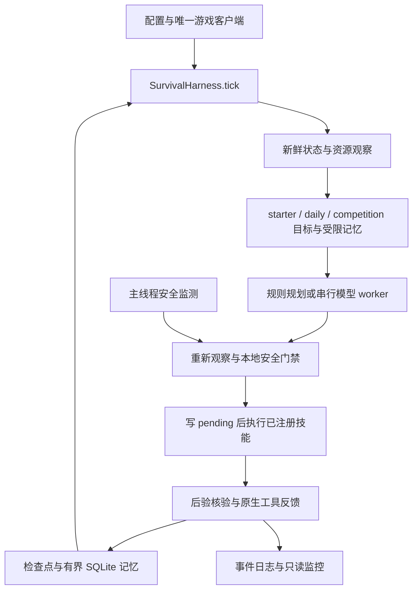

# BotSleep 架构与实现状态

更新：2026-11-17。源码核对基准：分支 `develop-tianya/shelter-workflow`（提交 `cee4a03` 之后本轮文档同步）。本页描述拉取与分层重构后的实际运行路径；未来赛事接口和已确认产品方向见 [HARNESS_INTERFACES.md](HARNESS_INTERFACES.md)。验证结果见 [TESTING.md](TESTING.md)，不要把设计图或历史实服状态当作当前验收。

## 1. 当前入口与运行模式

`main.py` → `core/config.py` 加载默认值、YAML、环境变量及命令行覆盖，创建一个配置作用域内的游戏客户端。`bot_sleep.py` 与根 `client.py` 是兼容转发，不是第二套实现。普通依赖为 `requirements.txt` 中的 requests/PyYAML；RCON 只用于可选开发测试，主循环不依赖它。

| 模式 | 控制器/规划器 | 完成与退出 |
|---|---|---|
| sleep（默认） | `SleepController` + 睡眠技能 | 夜间/雷暴找床、验证入睡及醒来；可取消，有超时 |
| survival/starter | `SurvivalHarness` + 规则或 `LLMSurvivalPlanner` | 根据当前物品/工作站核验初期石器目标；受步骤/时间/死亡预算限制 |
| survival/daily | 同一 harness + 日常任务板和本地策略 | 13 项任务动态重算，31 个模型工具；持续维护，无 starter 的最终 goal_complete |
| survival/competition | 同一 harness + `CompetitionTasks`、服务器 advancement 和 LLM | 125 项规则目录（120 个目标、5 个根节点）；模型可选 scored 目标，只有 fresh 服务器证据计分；所有目标检测后才可正常结束 |

开启模型需 `agent.mode: survival` 且 `llm.enabled: true`。`--check-config` 只检查配置，不连接服务。`.env` 不由主程序自动加载。主入口退出会关闭控制器、等待工作线程清理并登出；这不是设计中“模型对话 handoff 保持游戏会话”的实现。

## 2. 当前执行链

`DailySurvivalGoals`、`CompetitionTasks` 是本地任务组件，不是模型 subagent；当前无图中“多专项模型派发”一类运行时。主循环也没有把传送门、整树伐木或独立配方规划器接入模型分派。

另有开发路径：`--debug --radar` 创建 `ContinuousRadarSkill` 并开启 daemon 线程，读取客户端、将 POI/航迹写入 `MemoryEngine`。单独 `--radar` 不创建该对象。门户浇筑、独立合成与伐木需由程序显式调用；聊天的 `chop_skill`、`craft_skill` 注入槽在 `main.py` 尚未赋值。它们不继承生存 harness 的动作互斥、pending 和取消恢复保证。

模型每轮只提一个已注册的工具，程序验证参数与执行前状态，再派发有限技能或最多 8 步的小批任务。模型文本自报“完成”、API 返回 ok 或路径目标点存在，均不能替代技能的实际效果核验。

## 3. 模块职责

| 模块 | 已有职责 |
|---|---|
| `core/client.py` | 统一端点、认证、HTTP/业务错误与超时；保留原响应封装，列表型方法做结构转换 |
| `core/radar.py` | 3D 方块全景雷达测绘与关键 POI 定向扫描 |
| `core/recipes.py`、`data/recipes.json` | 886 个可合成产物的配方目录及前置解析；独立 `CraftItemSkill` 使用，不替换模型 `craft_item` |
| `skills/portal_speedrun.py` | 独立分步浇筑、点火与门框读取；坐标和阶段由调用者提供，未绑定模型工具 |
| `skills/portal_telemetry.py`、`skills/lava_lake_generator.py` | 前者主动读取门户动作前后状态并导出 JSON，后者通过 RCON 生成专用测试地形；不是只读 EventMonitor |
| `skills/crafting.py` | 智能 2x2/3x3 工作台调度合成与工作台自动回收 |
| `skills/mining.py` | `ChopTreeSkill`（整树连续伐木）与 `MineShaftSkill`（5 层斜井、工作站、地下暗河跨步绕行、`target_ys` 分层采矿与返表兜底） |
| `skills/action_workflow.py`、`skills/shelter.py`、`skills/container.py` | 确定性动作工作流引擎（`ActionWorkflowRunner`、`pillar_up`/`pillar_down`、`scaffold_drop`、`escape_to_surface`）、庇护所施工与双箱/熔炉窗口操作 |
| `core/world_3d.py`、`core/pathfinder_3d.py`、`core/cave_probe.py`、`core/mining_targets.py` | 通用持久化 3D 体素世界记忆（`VoxelWorld3D` SQLite chunk-zlib）、3D A* 与锚定搭桥规划器、洞腔探查与主世界 Y 层矿脉带规划 |
| `skills/world_navigator.py`、`skills/ore_harvester.py`、`skills/cave_explore.py` | 统一 3D 导航/微掘/疾跑合并/4 级撤退执行器、矿脉踩捡收割器与可持久化多分支洞穴探索（未绑定模型目录） |
| `core/structure_spec.py` | 标准结构蓝图（庇护所/矿井坐标变换、安全选址与结构验收）与挖掘/危险/可替代方块常量 |
| `skills/exploration.py` | 可开关后台雷达，约每秒读取状态，默认位移 6 格后扫描；不是寻路或导航执行器 |
| `skills/daily_survival.py` | 日常生存技能库（作物、狩猎、铁矿、装备、熔炼、储物、床门、5x5 庇护所） |
| `core/domain.py` | 共享领域常量（木种、床色、食物点、危险方块）、纯坐标/体素键解析、背包计数提取与 `TypedDict` 契约 |
| `core/skill_registry.py` | starter / daily / competition 技能注册表（目标作用域、终点安全复核标记、执行器槽位分发）单一事实源 |
| `core/retreat_controller.py` | 树冠/近敌分段撤退恢复状态机、失败落点冷却与中继恢复判定 |
| `core/survival_harness.py` | 串行任务推进、单游戏动作线程、独立模型 worker、安全复查、取消、失败退避和检查点 |
| `agent/llm_planner.py`、`agent/tools.py` | 按 objective 暴露 starter 9 / daily 31 / competition 36 工具；严格解析原生 tool call，保留配对工具反馈 |
| `core/competition_rules.py`、`core/competition_tasks.py` | 读取规则目录、计算可用性和服务器 advancement 证据、管理选择/完成/强退/终止及得分；不执行游戏动作 |
| `core/model_worker.py`、`core/model_gate.py` | 慢模型异步等待；同服务/凭据作用域的本机线程与进程门禁；未知请求持久化锁定 |
| `core/survival_state.py` | 有界观察、跨进程文件锁与原子检查点，按 API/账号/world_id 隔离并提供单实例 `instance_lock()`；pending 不自动重放 |
| `scripts/botctl.py` | 离线只读运维工具，检查生存实例锁、`pending` 意图及 `ModelRequestGate` 状态（`status` / `check-ready-to-replace`） |
| `agent/daily_survival.py` | 根据当前证据生成日常任务板、依赖、缺口和建议；competition 中仅作生存辅助，不是计分来源 |
| `core/daily_observation.py`、`core/daily_policy.py` | 日常证据采集、安全情境和模型放行条件；未知资源不当成可执行目标 |
| `skills/survival.py`、`skills/daily_survival.py` 等 | 采集、制作、移动、撤退、农业、熔炼、住所、容器等执行及后验验证 |
| `core/survival_memory.py` | 有界 SQLite 事件、地点和失败策略记忆；召回候选仍须重新观察 |
| `debug/` | 白名单聊天调试、脱敏日志、本机只读监控；不是人工比赛控制方案 |
| `integrations/ninjabrain/` | 独立末影之眼采样和官方计算核心；未绑定 starter/daily 模型目录 |

旧 `agent/loop.py` 和 `core/telemetry.py.ReflexDaemon` 仍有 TODO，但不是当前生存主循环。`core/memory.py` 与 `data/game_logic/` 现被开发雷达/独立伐木复用，但不是当前生存检查点或 SQLite 记忆。默认数据目录不按 API/账号/world_id 隔离，其中部分文件受版本控制，调试后须检查 diff。维护时不要据旧骨架推断整个系统未实现。

## 4. 模型请求与游戏动作的两套未知状态

**模型侧**：`ModelRequestGate` 在进程内/本机跨进程串行化请求。安全事件可取消旧模型提案的消费，但不能证明远端生成已结束；worker 等请求返回后排空，不执行过期提案。传输超时/连接中断留下 `uncertain`，重启不会自动放行。只有确认 provider 无在途请求后才可 `--acknowledge-model-idle`；不能用此参数试探解锁。明确 HTTP 错误按当前策略处理，模型失败不回退为规则采集。

**游戏侧**：动作前写 pending，结果不明则保存并暂停；`--resume` 重新观察后规划，不重发旧动作。不能用它解除模型请求未知状态。`stop` 是停止请求，不是服务器已释放动作锁的保证；本地取消也不能立即杀掉同步 HTTP。主进程退出可能等待请求超时，运行预算不是进程强杀期限。

两者都不是“失败即可重试”。同一机器人之外的外部进程控制权，以及通用分布式动作调度，尚未由当前实现全面解决。

## 5. 上下文、进度与记忆

当前规划器发送精简观察、目标板、受限记忆和最近完整原生工具事务；按历史轮数和请求 JSON 字节预算裁剪。starter 默认上限 30,000 字节，daily 48,000 字节（含工具定义），不是 provider 的 token 窗口。最近未交付工具结果受保护；当前输入本身过大则报 `llm_context_limit`，不发送请求。

这不是访谈确定的 Pi/OMP token-aware、模型语义摘要与持久化边界的自动 compact；显式 handoff、动态 SKILL.md 加载、重复输出→compact→force-exit 的完整机制也尚未实现。已有重复失败/目标冷却不应命名为完整 attention-collapse 检测。

当前 `SurvivalJournal` 保存 context/pending/last_result，并把 competition 状态按 API/账号/world_id 保存；终态重启后保持退出，非终态恢复仍需新鲜观察，pending 不自动重放。SQLite 记忆另有容量/召回预算。模型历史未作为跨进程对话自动恢复协议持久化。

## 6. 安全与导航边界

已有安全监测能识别近敌、生命、火/岩浆、水中和死亡等变化，取消过期模型提案或请求停止动作；日常策略可选择进食、睡眠、撤退和短安全观察。现场安全可能只能返回 unsafe/等待，不能宣称一定脱困。

现有生存模型内建移动/撤退技能仍以局部几何、支撑、净空、危险地形及位置后验检查为主；独立工作流层 `Pathfinder3D` / `WorldNavigator` / `ActionWorkflow` 已提供 3D A*、`blocked_edges` 规避、锚定跨涧搭桥、`pillar_up`/`pillar_down`、`scaffold_drop` 与 `escape_to_surface`。**生存模型主循环内的通用水面优先导航、surface_swim 与高频反射仍待正式接入**；普通 `move_to` 仍不保证自动浮水，也不依赖外部 API 补丁。

用户已确认的未来导航方向仍是：harness 全权规划、安全水面优先、不潜没时不计氧气、必要时按资源预算搭路；下意识行为可消耗资源应急，核验后续接原任务意图。实现前必须处理观察覆盖不足和动作互斥，不借用相邻 API 补丁。

## 7. 验证与下一步

当前 pull 后的源码状态和本轮离线复核与历史实服结果分别记录于 [TESTING.md](TESTING.md)。本轮不连接游戏/模型，不能据本轮离线复核宣布新版自然地图完整生存成功。

后续先复用现有配置、客户端、模型门禁、后验验证和检查点机制，再补语义 compact/handoff、阶段 skill 加载与水面/搭路导航执行器；competition 任务选择和退出的基础闭环已实现。不要并行新建第二套无人维护的调度/认证体系；未来接口名见 [HARNESS_INTERFACES.md](HARNESS_INTERFACES.md)，未实现入口不得广告给模型。

## 8. 协作开发与分支规范

为保障多人协作与版本隔离：

- **主分支 (`main`)**：保持纯净且可稳定部署的代码基准。
- **个人工作分支 (`develop-tianya`)**：用于 TianYa 的个人功能开发、测试与阶段性提交。
- **存档隔离原则**：Minecraft 运行世界（`world/`）与庞大二进制必须物理隔绝在独立服务端，严禁推送到 Git 仓库。
- **密钥安全**：本地配置文件（`config.yaml`）已配置 `.gitignore` 绝不入库，示例见 `config.example.yaml`。
