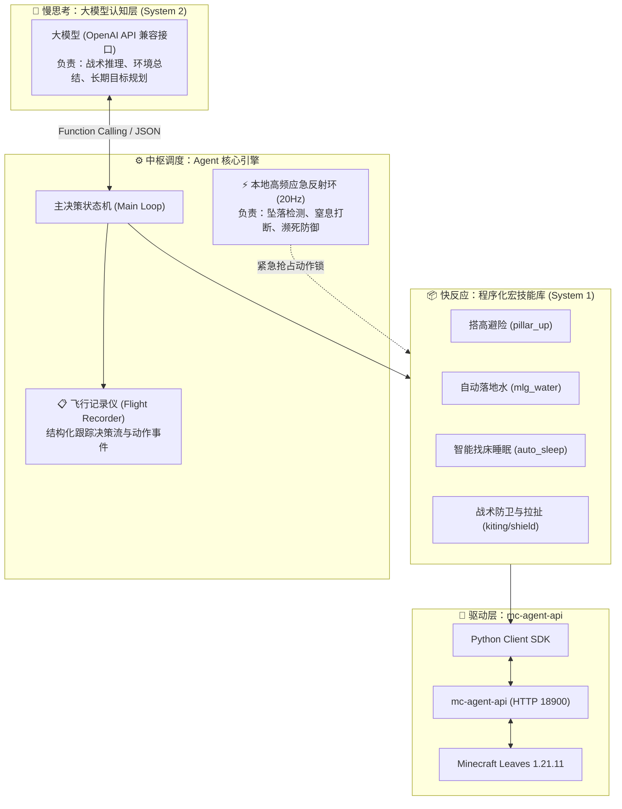

# BotSleep 系统架构设计规范 (ARCHITECTURE)

## 一、设计哲学：慢思考与快反应 (Dual-System Model)

在 Minecraft 这种三维物理沙盒游戏中，AI Agent 面临着严峻的时延与物理反馈挑战。
如果将所有的观察与动作完全交给大模型端到端处理，会产生致命弊端：
1. **网络与推理时延过大**：大模型（如 GPT-4 / DeepSeek / 本地大模型）单次推理耗时通常在 0.5s ~ 2.5s 之间，而 Minecraft 游戏以 20 TPS（每刻 50ms）运转。
2. **硬实时动作易暴毙**：类似“自动落地水 (MLG Clutch)”、“跳跃躲避伤害”这类操作要求在 1~3 个游戏刻（50~150ms）内完成，必须由本地程序化状态机直接响应。

因此，**BotSleep 采用“双脑分层决策系统”**：

---

## 二、系统核心分层规范

### 1. 认知层 (Cognitive Layer - `agent/`)
- **定位**：战略指挥官。
- **协议**：统一采用 OpenAI 兼容协议（支持 Official OpenAI、DeepSeek、Qwen、Ollama、vLLM 等）。
- **交互方式**：
  - **Tool Calling (Function Calling)**：向大模型注册宏技能的 JSON Schema。
  - **ReAct 循环**：感知 (Observation) $\rightarrow$ 思考 (Thought) $\rightarrow$ 调用宏动作 (Action) $\rightarrow$ 获取反馈 (Feedback)。

### 2. 调度与反射层 (Agent Core & Reflex - `core/`)
- **Main Loop**：驱动认知层与技能层的标准事件循环。
- **Reflex Daemon (应急反射环)**：
  - 独立轻量后台线程，以 20Hz 频率监听客户端状态快照。
  - 遇到致命危机（如垂直下落速度超过阈值、坠落高度 $> 4$）时，**立即抢占动作锁**，强制执行硬实时反射技能（如自动落地水）。

### 3. 宏技能库 (Procedural Skill Library - `skills/`)
- **定位**：战术执行兵。
- 封装高阶、原子化的复合游戏操作，屏蔽底层繁琐的连续包交互：
  - `movement.py`：自动搭高避险 (`pillar_up`)、搭桥渡河、潜行下蹲。
  - `clutch.py`：自动落地水 (`mlg_water`)、防摔兜底。
  - `sleep.py`：环境检测、床位搜索寻路、入睡与黎明唤醒 (`auto_sleep`)。

### 4. 驱动与感知层 (Driver Layer - `core/client.py`)
- 基于 HTTP RESTful 协议与 `mc-agent-api` 交互。
- 封装 Token 认证、连接维持、动作等待、结果验算、异常拦截。

---

## 三、数据与事件流转规范

1. **状态感知归一化**：
   原始游戏包 $\rightarrow$ `mc-agent-api` $\rightarrow$ `core.telemetry` 进行降噪处理（提取位置 `pos`、昼夜 `is_day`、威胁生物列表、视野方块摘要）。
2. **上下文压缩与 Token 节约**：
   不直接将全量三维方块传给大模型，而是通过程序化过滤，仅向大模型注入：
   - 目标相关方块（如床、工作台、箱子、门）
   - 危险警报（敌对生物距离、着火、溺水、虚空）
3. **动作执行与互斥保护**：
   `mc-agent-api` 具有动作互斥机制（正在寻路或挖掘时返回 `busy`）。技能层必须具备重试队列与取消超时机制。
