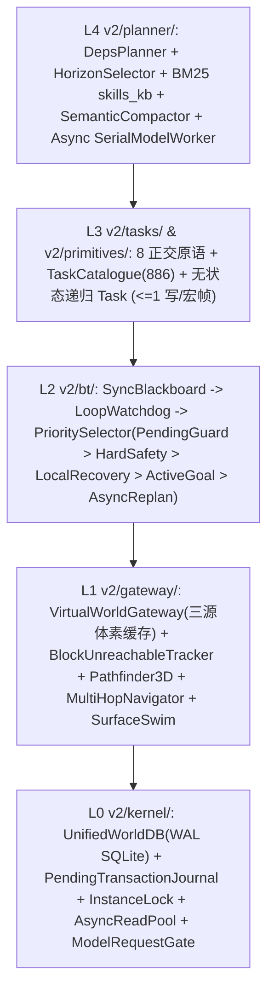

# BotSleep 架构与实现状态

更新：2026-11-26（已通过 `develop-tianya/rewrite-v2` 完成 L0–L4 重写并合入 `main`；旧版 v1 源码永久归档于 Git 分支 `archive/v1` 与标签 `archive/v1-final` @ `c6859dc`，对应总纲见 [REWRITE_V2_MASTERPLAN.md](REWRITE_V2_MASTERPLAN.md) 与 [REWRITE_V2_AGENT_PLAN.md](REWRITE_V2_AGENT_PLAN.md)）。验证结果见 [TESTING.md](TESTING.md) 与 [LIVE9_90M_REPORT_20261126.md](LIVE9_90M_REPORT_20261126.md)，历史交接背景见 [HANDOFF.md](../HANDOFF.md)。

## 1. 当前入口与运行模式（BotSleep v2）

`main.py` → `v2/kernel/config.py` 加载默认值、YAML、环境变量与命令行覆盖，初始化单向五层微内核并在 `v2/app.py` 中运行。根目录 `bot_sleep.py`（转发 `main.py`）与 `client.py`（转发 `v2.kernel.client`）保留兼容薄壳，不再复制实现；普通依赖为 `requirements.txt` 中的 `requests` 与 `PyYAML`。

旧版过程式代码与旧测试套件（原 `core/`、`agent/`、`skills/`、`debug/`、`probe_api.py`、`tests/`）已永久归档至 Git 分支 `archive/v1` 及标签 `archive/v1-final`（`c6859dc`），当前 `main` 工作区已彻底移除上述旧文件及临时 `legacy/` 目录；`v2/`、`scripts/` 与 `integrations/` 实现零旧模块依赖（由 `tests_v2/test_10_ops_and_cli.py` AST 守护）。

| 模式 | 控制器 / 规划器 | 完成与退出 |
|---|---|---|
| `sleep`（默认） | `BTRuntime` + `LocalRecoveryBranch`（夜间自动寻床入睡） | 夜间/雷暴就近寻床入睡与醒来；可 `#stop` 暂停，有超时 |
| `survival/starter` | `BTRuntime` + `DepsPlanner`（规则或 `OpenAIBrain`） | 核验开局采集/制作石器与基础工具链；受步骤/时间/死亡预算限制 |
| `survival/daily` | `BTRuntime` + 15 张 `skills_kb/*.md` + `TaskCatalogue`（886 配方） | 行为树反应式抢占 + `SerialModelWorker` 非阻塞异步规划 + `SemanticCompactor`（`<= 6.6KB`） |
| `survival/competition` | 同一 `BTRuntime` + `v2/tasks/competition/`（5 工具与服务端 `/advancements`） | 45 无条件 + 54 条件 override 门禁；`--new-competition` 重置；只认服务端计分真值 |

开启模型规划需同时设置 `agent.mode: survival` 与 `llm.enabled: true`。`--check-config` 只校验配置，不连接服务器；`--keep-connected` / `mc_api.keep_session_on_exit` 控制退出时是否保持游戏连接。

## 2. L0–L4 单向五层执行链（由 `test_00_layer_boundaries.py` AST 强制约束）

## 3. 核心模块职责与安全契约

| 层级与目录 | 核心职责与硬性不变量 |
|---|---|
| `v2/domain.py` | 纯共享常量、坐标/朝向变换、四朝向 `StructureSpec`、威胁半径与方块分类 |
| `v2/kernel/`（L0） | `config.py` 配置加载；`client.py` 拆分单线程写 Session 与 `threading.local()` 只读池；`storage.py` + `journal.py` 维护作用域 WAL 库、实例锁与写前 `pending_tx`（`unknown` 冻结不重放）；`model_gate.py` 保证跨进程模型请求串行并发=1 与 30s 传输恢复窗口 |
| `v2/gateway/`（L1） | `world_proxy.py` 融合 `find_blocks`、`get_block` 与站位推断并做 `y+0.85`/`y-0.01` 桶视线规划；`unreachable.py` 按 `(dim, pos, action)` 持久化 TTL 黑名单；`pathfinder_3d.py` 维护起点 3×3 预取、按需补读与 `avoid_block_breaking`；`multihop_navigator.py` 切片多跳、3D 微掘/搭柱/搭桥并经 `_precision_nudge` 桥接上游 `goNear()` `<= range + 0.5` 盲区 |
| `v2/bt/`（L2） | `SyncBlackboard` 每帧并发拉取状态/库存/实体/增量 `/events`；`Node.stop(bb)` 立法**纯内存零网络写**；`HardSafety` 含热危害避让与举盾进出半径迟滞；`LocalRecovery` 含饮食、浮水与树冠寻树干安全下树；`LoopWatchdog` 追踪 Bounding-Sphere 停滞并豁免 `smelt_waiting_furnace` 与有界 `nether_portal_waiting` |
| `v2/primitives/` & `v2/tasks/`（L3） | `Navigate / DigCollect / PlaceBuild / Craft / Container / Fluid / Combat / Utility` 八大单写原语与无状态递归任务；`EnterNetherTask` 实现保护区防门前挖坑、先水后岩浆浇筑 10 格模具、远距离取水点回退及有界进门等待 |
| `v2/planner/` & `skills_kb/`（L4） | `DEPS` 失败诊断、`HorizonSelector`（含 `PORTAL_GATE_READY`）、15 张 `skills_kb/*.md` 零依赖 BM25 召回、`SemanticCompactor`（`ProgressCard` + 最近 2 组工具事务 `<= 6.6KB`）及 `IntentCompiler` |
| `v2/observability/`、`scripts/`、`integrations/` | `FlightRecorder` 脱敏日志、`MonitorServer` 只读面板、`ChatDebugger`、`scripts/botctl.py` 运维检查、`scripts/multi_bot_runner.py` 多实例编排、与旧版解耦的 `integrations/ninjabrain/` |

## 4. 协作开发与分支规范

- **主分支 (`main`)**：当前运行 **BotSleep v2**（L0–L4 架构）的稳定基准分支；拉取更新时 Git 自动清理旧版根目录并切至 `v2/`。
- **旧版归档 (`archive/v1` / `archive/v1-final`)**：原 v1 代码终态（`c6859dc`）永久归档保存于独立分支与标签，不再占用主工作树。
- **开发分支 (`develop-tianya/rewrite-v2`)**：L0–L4 重写与持续实服优化所在开发分支；外部 `mc-agent-api` 始终保持零源码改动。
- **存档与密钥安全**：Minecraft 运行世界（`world/`）物理隔绝在独立服务端；`config.yaml`、`.env`、`.venv/` 与 `logs/` 已配置 `.gitignore` 绝不入库，示例见 `config.example.yaml`。
