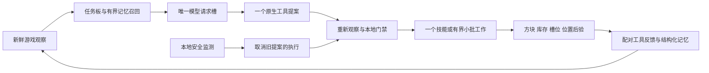

# 日常生存：任务、反馈与长期记忆

本页描述 2026-11-14 的 BotSleep 日常生存实现。`survival.objective: daily` 在初期工具链之上持续检查食物、材料、设施与安全，不以取得石器后的 `goal_complete` 结束。已完成源码接线和离线回归；普通地图的完整日常闭环仍须真实验收。历史采木、制作或专用平坦场石器成功不能替代这项验收，具体记录见 [TESTING.md](TESTING.md)。

## 入口与执行链

沿用现有私密配置，设置 `agent.mode: survival`、`survival.objective: daily`；需要模型决策时启用 `llm.enabled`。未启用模型时，任务图可提供规则模式下的一个动作，两种模式都经过本地安全策略与技能验证。

```powershell
# 只校验配置，不连接游戏或模型。
python main.py --config config.yaml --mode survival --objective daily --check-config

# 真正启动；会连接配置指定的账号与世界，必须使用已确认的配置。
python main.py --config config.yaml --mode survival --objective daily
```

已暂停的检查点默认保持暂停。`--resume` 仅解除控制器暂停，随后重新观察、重新决策，不重放 `pending` 中的旧动作，也不解除模型请求未知状态。步骤、运行时长与死亡预算仍然有效；“持续维护”不等于无限后台运行。

| 模块 | 当前职责 |
| --- | --- |
| [core/daily_observation.py](../core/daily_observation.py) | 在基础观察上取得作物、熔炉/容器、住所和短返家路线的当前证据。 |
| [agent/daily_survival.py](../agent/daily_survival.py) | 根据当前库存和设施生成任务板、缺口、依赖、行动建议与待重新核验的记忆地点。 |
| [core/daily_policy.py](../core/daily_policy.py) | 纯本地安全决策；近敌、生命、饥饿、暮夜与返家门禁优先于一般生产任务。 |
| [skills/daily_survival.py](../skills/daily_survival.py) | 采矿、农作、狩猎、护甲、熔炼、容器、掉落回收、床和门等有后验检查的技能。 |
| [skills/shelter.py](../skills/shelter.py) | 有界勘测、固定小屋蓝图、逐块建造与住所几何检查。 |
| [skills/batch.py](../skills/batch.py) | 最多 8 步的采集或施工，每步重新校验，失败立即停止，不额外请求模型。 |
| [skills/doors.py](../skills/doors.py)、[skills/positioning.py](../skills/positioning.py) | 门的显式开闭与双半状态确认；同层 3 格内的精确工作站位和完整身体净空检查。 |
| [core/survival_memory.py](../core/survival_memory.py) | 按服务器、账号、世界隔离的 SQLite 事实记忆；不访问模型或游戏。 |
| [core/model_gate.py](../core/model_gate.py) | 同一模型服务及凭据下的本机跨线程、跨进程互斥与未知请求台账。 |
| [core/survival_harness.py](../core/survival_harness.py) | 串行观察、模型请求、安全复查、意图落盘、技能执行、结果反馈与检查点。 |

每轮先观察，再更新记忆与任务板。模型得到压缩后的当前证据、缺口和记忆候选，一次只选择一个注册工具；返回后再次观察并检查安全条件。实际技能结果进入配对的 `tool_call_id` 反馈，下一轮据此调整。日志的模型名采用服务返回的 `response.model`，请求路由 `default` 本身不证明实际型号。



图中的取消不释放仍在远端执行的请求槽。近敌、死亡、掉血或环境危险可抢占慢模型；旧提案返回后被排空，不能继续执行。低血且无现成食物时，只在白天、2 格内存在已观察可直接取食的目标及完整邻域证据时放行受限模型回合。collector 最多补读两个目标及各自六邻格；未知仍是未知。初始低血不会反复取消这个救食回合，新增掉血、位置/生命变化或近敌仍会取消。

## 借鉴 with-you 的部分

参考项目 `with-you.exe/scripts/ai/ai_director.gd` 将动作事件送回下一次感知，并把任务状态和 `last_result` 留在上下文；`scripts/ai/ai_memory_store.gd` 区分近期事件与长期记忆，记录来源、时间，并限制近期数量、检索数量和摘要长度。BotSleep 采用“观察—行动—实际结果—下一轮调整”以及有界记忆的原则。

BotSleep 的实现适配 Minecraft 的外部副作用：使用原生工具调用及配对结果；任务满足与否由本地新证据计算；长期记忆只接收结构化证据；不额外调用模型生成记忆或并行细化动作。模型错误不会悄悄切换为规则采集。with-you 的对话/情绪字段、任意文本记忆和模型离线回退机制不属于这里的完成能力。

## 当前任务板如何表示进度

任务包括安全掉落回收、食物储备、木材储备、初期工具、已放置熔炉、燃料、铁器、建家站点、床、住所、储物、食物生产点与维护。每项包含 `status`、`missing`、`evidence`、`depends_on`、`blocked_reason` 和可能的 `next_action`；状态是 `ready`、`running`、`waiting`、`blocked` 或 `satisfied`。

`maintenance_ready=true` / `phase=maintain` 只表示本次观察满足代码定义的当前条件，仍会周期性复查。库存消耗、设施损坏、死亡或观察缺失都会使任务重新出现缺口。它不证明已经在游戏里完成一整天、照明安全、作物稳定产出或长期不死。

默认食物、木材和燃料目标分别为 8、8、8，维护间隔为 30 秒，可在 `survival.daily` 中调整。木材按原木当量统计；食物项数和燃料项数不是饱食度或燃烧时长保证。

## 观察与技能证据

### 容器与熔炉

官方 `window_view` 会打开/关闭窗口，并可能隐式接近目标，不能视为无副作用的任意远程读。collector 只对当前落地、距离不超过 3 格的最多两个不同窗口依次检查，每个窗口前后检查生命、维度、位置与忙态；窗口返回的站点名称必须匹配。

显式空槽 `[]` 才表示空槽。缺失槽、未知内容、错误窗口或读取超时不能变成“空熔炉/空箱子”。不确定窗口读取使本次观察立即结束，不追加第二个窗口、材料转移或 `stop`；随后仍须等待后端空闲并重新观察。

熔炼开始只证明输入和燃料转移，产物必须在后续当前窗口中观察并收取后验算库存。官方 `burning=false` 在窗口进度属性尚未到达时也可能出现，因此仅按原版字段证据处理，不能当作额外的服务端任务完成保证。部分转移或未知写入结果保留 `pending`，不得自动重放。

### 农作与住所

`gather_seeds` 为没有村庄作物的开局提供小麦种子来源；单次只采一株已观察短草/高草，高草核验两半。草移除成功但随机无种子时返回 `gained=0, completed=false`，只有种子实际进入库存才推进后续种植。草查询与大量泥土查询分开，最多8株、48次额外方块读。

树冠/资源的局部遮挡可通过 `clear_foliage` 清一格已知可见叶片或藤蔓：只允许八邻身体高度、3格内、白天、生命至少12、饥饿至少8、无近敌、落地干燥，禁止自身整列及支撑。仅一次 `dig(collect=False)`，不接近、不追掉落物；只凭方块变为空气确认。未知结果直接保留暂停，不重挖。观察最多检查16个相邻脚部/头部格，视线共享缓存后额外读取上限32；资源的遮挡坐标进入模型，每类最多8个资源中保留至多2个近处明确遮挡的候选，避免远处未知目标挤掉局部解法。任务建议优先清精确遮挡格，再重新观察，不把清叶本身当作已采得原木或已经脱困。

农作证据重新读取作物种类、合法生长年龄和下方耕地。至少 4 个不同位置的当前活作物及耕地可标记 `renewable=true`，含义仅为当前可继续种植、维护的生产点；照度、水源和持续产量没有在该标记中得到证明。`lighting`、`water_source` 保持 `unknown`，`sustained_yield_guaranteed=false`。

`plan_shelter` 检查固定 5×5 站点的天然类型实心地面、三格高净空、危险与出口，不拆除现有障碍。API 无法判断方块属于哪个玩家，不能由“天然类型”推断所有权。蓝图包含两格高外墙、屋顶和北侧单门口；普通建材共 55 格，门另外放置。每次 `build_shelter_step` 最多补一格，并要求目标方块匹配和库存恰好减少一件。未知、占用或可能堵住身体/出口时拒绝；站位候选只证明被观察的空间，不保证寻路可达。

门的 `frame_verified` 要求木门上下半格、朝向、铰链和开闭状态一致，北墙门须朝南或朝北。`structure_complete` 可以在门打开时成立；`shelter_verified` / `geometry_complete` 仍要求门闭合及地面、墙、屋顶和出口证据完整。门口为空、只造屋顶、床或箱子在背包里，均不等于已建成住所。照度与室内刷怪条件未知，几何庇护不等于完全防怪。

`set_door` 指定最终开闭状态，已符合时不操作，未知结果不再次切换。床的实际朝向受原版 API 放置时自动看向支撑面影响；先到侧边前排精确站位，再把床脚放在侧边中排、床头朝后排，保留中央通道。`position_for_task` 只走同层近距、完整碰撞箱和支撑已重新读取的走廊；API 报成功后仍须检查实际脚格与中心误差。读取预算、未知几何、树叶、门或危险会阻止该精确移动，不能当作通用寻路保证。

返家证据位于 `daily_evidence.shelter.return_route`：同高度、不超过 4 步的四邻接整数脚位置，重新检查起点碰撞箱涉及的支撑、脚部和头部，以及每个后续格的支撑与身体空间。唯一阻挡是正确的已闭合双格门时，返回 `verified=false` 和 `blocked_door`；开门后必须重新观察才可使用通路。室内离门较远且门开着时，可提供到屋内中心的短路线，以便再次近距离关门。`actual_path_verified=false` 表示这仍不是后端实际行走轨迹的证明。

## 记忆不能替代当前事实

记忆按规范化 API 地址、账号和 `world_id` 的摘要隔离。改世界但沿用同一地址时必须更新 `world_id`，不能让新地图继承旧地图的地点语义。SQLite 事务保存三类记录：

- `episodes`：实际动作、成功/失败、库存增减或生命变化的结构化事件。
- `places`：带维度、坐标、来源、时间、TTL、置信度的设施、资源、危险与住所候选。同名不同位置分别保存。
- `strategies`：某类失败及目标的次数与有限策略码，例如重新观察、换目标、补材料、重试前核实。

默认最多保留 256/128/128 条，各行和数据库页数都有上限；检索同时限制返回条数与完整 JSON 字节数，主循环当前取最多 6 条、2500 字节。只保存允许的结构化字段，不保存游戏聊天、原始推理或任意文本段落，并对登记的凭据与常见密钥格式脱敏。

没有观察到不等于证明不存在。部分或未知观察不会清空地点；实际读取到方块已替换才更新该地点身份。死亡和维度变化会失效临时资源/失败策略，永久设施降为待重新核验的候选。所有 recall 地点都需要重新观察：记忆不是当前库存、安全路线、已完成任务或可重放动作的真值。

## 单模型请求与未知状态

生产模型调用通过凭据作用域的线程锁、操作系统文件锁和原子请求台账串行执行。台账存摘要路径、请求标识和状态，不存明文凭据；约束覆盖同一台机器上使用此门禁的 BotSleep 进程，不声称能约束外部程序或其他机器。

完整 HTTP 响应已经结束时，释放模型槽位；明确的 429/5xx 等失败可按现有退避策略再请求。超时、网络异常或请求中进程退出不能证明远端已停止计算，台账保留 `uncertain` / 未结束的 `inflight`。等待、重启和 `--resume` 都不会自动清除它；后续请求在发送前以 `llm_request_uncertain` 拒绝。

只有操作人确认服务端已经没有进行中的请求后，才可使用 `--acknowledge-model-idle` 显式清除该状态。该参数不是自动检测，也不应作为每次启动的固定参数。日常模式可继续本地、经过新观察的进食/撤退/等待安全行为，但不会因模型阻塞自动开展规则生产。

## 本轮验证边界与运行交接

全套 **740 项测试通过（15.126 秒）**；其中观察模块46项、日常技能63项、住所模块21项、记忆模块30项、模型门禁7项、日常runtime12项，另有慢模型取消、低血近距取食、精确床位、小批工作与原生反馈测试。它们检查有界读取、未知不作空、状态变化、门与路线证据、逐块库存验证、记忆隔离与容量、崩溃后请求不重发等；不连接真实 Minecraft 或模型服务。

真实运行的 API 仍要求使用官方源码，不依赖相邻仓库的本地补丁。当前真实进程、配置和日志以私有 `.test-runtime/processes.json` 与只读监控的时间戳为准；修改源码或离线测试通过都不证明运行中的进程已加载新模块。运维 `maintenance` 状态与任务板 `phase=maintain` 是不同概念。

本轮开发检查点的 HTTP 核验：监控进程 PID38332，`run.state=paused`、`planner=paused_for_development`、`steps=0`、`pause_reason=daily_survival_implementation`；`status.ready=false`、`connected=false`、`maintenance=true`，保留的最后游戏观察时间为 `2026-11-14T06:19:29Z`。这只是开发维护页，新增日常代码当时尚未加载到实际自主机器人，不能据页面在线或旧观察判断当前游戏状态。正式恢复后的运行信息应另按会话登记。

本轮完整真实日常验收尚未在本页登记：需分别记录自然地图上的食物净增与进食、熔炼产物收取、铁器制作、真实建屋/开门进入/关门、储取物品、种植后的后续生长收获，以及一次实际失败后的配对反馈和新行动。没有自然发生的失败不能靠注入故障凑数；不能给物、传送、改时间或改地图来冒充普通世界自主成果。最终会话、模型实际返回名、动作后验与未完成项由现场验收记录补充。

开发维护页已于15:17结束。15:40会话 `b8b27ada1620` 随后真实完成清叶、两次采木、木板/木棍和木镐制作，并在缺料、移动失败后调整行动；实际响应自报 `qwen3.6-35b-a3b`。16:03夜间撤退期间被僵尸击杀，重生后继续观察。它证明了部分生产与反馈链，仍未通过食物、熔炼、建屋、储物和持续安全生存的整体验收。最新运行和历史证据区分见 [TESTING.md](TESTING.md) 顶部。
