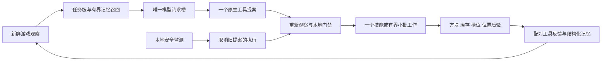

# 日常生存：任务、反馈与长期记忆

当前说明更新于 2026-11-16；下方保留较早的测试与实服记录。`survival.objective: daily` 在初期工具链之上持续检查食物、材料、设施与安全，不以取得石器后的 `goal_complete` 结束。当前 starter/daily/competition 工具数为 9/35/40；新增战斗、取液与条件岩浆狩猎已接入源码及离线回归，普通地图的完整日常闭环仍须真实验收。历史采木、制作或专用平坦场石器成功不能替代这项验收，统一验证记录见 [TESTING.md](TESTING.md)。

## 目标程序与原子动作

默认启用的 `run_survival_task` 支持 12 类目标：`gather/craft/smelt/food/starter_tools/iron_tools/shelter/bed/storage/farm/recover_drops/maintenance`。模型授权目标后，程序复用现有任务前置与技能，一步一观察、一动作一 pending、一结果一核验；不用每采一块或放一块都重新询问模型。现有 13 项日常证据任务板、12 类可执行目标程序和赛事得分目录是不同层次，数量不能混用。

autonomy 启用时，正常任务阶段的实际模型请求只携带目标工具及必要安全/赛事管理工具；程序报告 `needs_ai` 才开放原子修复工具。模型不能仅因忽略 prefer 提示就持续绕过目标程序逐块操作。9/35/40 指完整注册目录，实际请求暴露数量随阶段变化。

默认每目标 128 步/600 秒、4 次连续本地失败、8 次无进展、8 次局部探索；到边界返回真实进度、缺口与原因。安全应急挂起目标并由本地策略先处理，未知副作用冻结，不自动重放。正常子步骤没有独立模型工具调用；原生目标反馈在完成、需要 AI、未知或显式暂停/取消边界配对一次。关闭 `survival.autonomy.enabled` 则移除目标工具，原单步模式保留。详细参数、配方子集、恢复与监控见 [AUTONOMOUS_TASKS.md](AUTONOMOUS_TASKS.md)。

## 入口与执行链

沿用现有私密配置，设置 `agent.mode: survival`、`survival.objective: daily`；需要模型决策时启用 `llm.enabled`。未启用模型时，任务图可提供规则模式下的一个动作，两种模式都经过本地安全策略与技能验证。

```powershell
# 只校验配置，不连接游戏或模型。
python main.py --config config.yaml --mode survival --objective daily --check-config

# 真正启动；会连接配置指定的账号与世界，必须使用已确认的配置。
python main.py --config config.yaml --mode survival --objective daily
```

已暂停的检查点默认保持暂停。`--resume` 仅解除控制器暂停，随后重新观察、重新决策，不重放 `pending` 中的旧动作，也不解除模型请求未知状态。步骤、运行时长与死亡预算仍然有效；“持续维护”不等于无限后台运行。

| 模块 | 当前职责 |
| --- | --- |
| [core/daily_observation.py](../core/daily_observation.py) | 在基础观察上取得作物、熔炉/容器、住所和短返家路线的当前证据。 |
| [core/autonomous_tasks.py](../core/autonomous_tasks.py)、[core/autonomy_runtime.py](../core/autonomy_runtime.py) | 根据已授权目标与每轮观察规划一个原子子步，处理目标预算、本地恢复和一次原生终态反馈。 |
| [agent/daily_survival.py](../agent/daily_survival.py) | 根据当前库存和设施生成任务板、缺口、依赖、行动建议与待重新核验的记忆地点。 |
| [core/daily_policy.py](../core/daily_policy.py) | 纯本地安全决策；近敌、生命、饥饿、暮夜与返家门禁优先于一般生产任务。 |
| [skills/daily_survival.py](../skills/daily_survival.py) | 采矿、农作、狩猎、护甲、熔炼、容器、掉落回收、床和门等有后验检查的技能。 |
| [skills/combat.py](../skills/combat.py) | 对白名单敌人的单次攻击/射击或短退步，按装备自动选择有盾/无盾分支，维护交战预算及防御释放。 |
| [skills/buckets.py](../skills/buckets.py) | `collect_liquid` 与已有不燃容纳坑内的 `hunt_with_lava`，核验桶内容、源液与实际收益。 |
| [core/survival_playbook.py](../core/survival_playbook.py) | 从已有证据生成 survival/speedrun 阶段建议、缺口和已绑定动作，不调用模型或游戏。 |
| [skills/shelter.py](../skills/shelter.py) | 有界勘测、固定小屋蓝图、逐块建造与住所几何检查。 |
| [skills/batch.py](../skills/batch.py) | 最多 8 步的采集或施工，每步重新校验，失败立即停止，不额外请求模型。 |
| [skills/doors.py](../skills/doors.py)、[skills/positioning.py](../skills/positioning.py) | 门的显式开闭与双半状态确认；同层 3 格内的精确工作站位和完整身体净空检查。 |
| [core/survival_memory.py](../core/survival_memory.py) | 按服务器、账号、世界隔离的 SQLite 事实记忆；不访问模型或游戏。 |
| [core/model_gate.py](../core/model_gate.py) | 同一模型服务及凭据下的本机跨线程、跨进程互斥与未知请求台账。 |
| [core/survival_harness.py](../core/survival_harness.py) | 串行观察、模型请求、安全复查、意图落盘、技能执行、结果反馈与检查点。 |

每轮先观察，再更新记忆与任务板。没有活动目标且安全策略允许时，模型得到当前证据、缺口和记忆候选，选择一个注册工具；返回后再次观察并检查安全条件。普通技能结果直接进入配对的 `tool_call_id`；目标工具保留这一事务，由程序执行多次已核验子步后，在目标边界回传汇总。日志的模型名采用服务返回的 `response.model`，请求路由 `default` 本身不证明实际型号。

`survival.intent` 默认 `survival`；显式 `speedrun` 只改变 `context.playbook` 的阶段建议，不扩大工具权限或自动执行队列。完整观察才更新建议；短安全观察保留旧阶段但标记 `fresh=false`。盾、桶和铁镐是阶段前置，已观察到的副手盾不重复制作，已有储存备份工具也不会因补盾而被忽略。下界移动、交易、要塞采样执行和末地战斗等尚未绑定环节必须显示缺口，详见 [SURVIVAL_PLAYBOOK.md](SURVIVAL_PLAYBOOK.md)。



图中的取消不释放仍在远端执行的请求槽。近敌、死亡、掉血或环境危险可抢占慢模型；旧提案返回后被排空，不能继续执行。低血且无现成食物时，只在白天、2 格内存在已观察可直接取食的目标及完整邻域证据时放行受限模型回合。collector 最多补读两个目标及各自六邻格；未知仍是未知。初始低血不会反复取消这个救食回合，新增掉血、位置/生命变化或近敌仍会取消。

## 借鉴 with-you 的部分

参考项目 `with-you.exe/scripts/ai/ai_director.gd` 将动作事件送回下一次感知，并把任务状态和 `last_result` 留在上下文；`scripts/ai/ai_memory_store.gd` 区分近期事件与长期记忆，记录来源、时间，并限制近期数量、检索数量和摘要长度。BotSleep 采用“观察—行动—实际结果—下一轮调整”以及有界记忆的原则。

BotSleep 的实现适配 Minecraft 的外部副作用：使用原生工具调用及配对结果；任务满足与否由本地新证据计算；长期记忆只接收结构化证据；不额外调用模型生成记忆或并行细化动作。模型错误不会悄悄切换为规则采集。with-you 的对话/情绪字段、任意文本记忆和模型离线回退机制不属于这里的完成能力。

## 当前任务板如何表示进度

任务包括安全掉落回收、食物储备、木材储备、初期工具、已放置熔炉、燃料、铁器、建家站点、床、住所、储物、食物生产点与维护。每项包含 `status`、`missing`、`evidence`、`depends_on`、`blocked_reason` 和可能的 `next_action`；状态是 `ready`、`running`、`waiting`、`blocked` 或 `satisfied`。

`maintenance_ready=true` / `phase=maintain` 只表示本次观察满足代码定义的当前条件，仍会周期性复查。库存消耗、设施损坏、死亡或观察缺失都会使任务重新出现缺口。它不证明已经在游戏里完成一整天、照明安全、作物稳定产出或长期不死。

默认食物、木材和燃料目标分别为 8、8、8，维护间隔为 30 秒，可在 `survival.daily` 中调整。木材按原木当量统计；食物项数和燃料项数不是饱食度或燃烧时长保证。

## 观察与技能证据

### 短步战斗、狩猎与桶

`fight_hostile{entity_id,expected_name}` 仅面向当前观察的骷髅、僵尸、苦力怕。近敌短观察可有界补读新鲜库存，由与技能共享的纯规则决定防御或撤退；仍是 safety scope，不能授权采集、制作等生产。每步重验生命、目标、武器与地形，不长距离追击；苦力怕点火状态未知，不做近战击杀。交战预算、连续未证伤害或 `retreat_required` 会使后续本地动作优先撤退，不需等待另一轮模型。规则与模型共用该门禁；已知战斗失败要求撤退时不受普通生产失败退避/熔断阻断，仍保留真实失败反馈。慢模型提案可被取消，返回后也必须重新校验。

单次短步成功不等于命中或击杀，目标消失也不等于死亡；比赛分数只认服务器 advancement。确认无威胁后才释放本技能举起的盾，该内部步骤独立写 pending，未知结果仍暂停。技能结果、退避要求和后验数据进入事件、记忆与监控，不能将它们变成未经复查的行动队列。

普通 `hunt_animal` 在 2.8 格内站定攻击猪、牛、羊、鸡；更远的已观察目标先给安全接近建议，然后重新观察，不边追边打。只认当前生/熟肉等库存净增；`hunt_unverified` 后先观察实际掉落，不能盲目重打。`collect_liquid{pos,expected_name}` 使用已有空桶取水/岩浆源；`hunt_with_lava{entity_id,expected_name}` 只接受已有不燃容纳坑，短点燃后立即核验回收源液，取得食物仍须库存后验。

`action_unconfirmed`、`action_state=unknown` 保留 pending。`combat_unknown`、`unknown_bucket`、`disconnected_unknown` 等明确清理限制不得被上层覆盖为追加 stop、重击或重倒岩浆。详细条件及限制见 [COMBAT_AND_HUNTING.md](COMBAT_AND_HUNTING.md)。

### 容器与熔炉

官方 `window_view` 会打开/关闭窗口，并可能隐式接近目标，不能视为无副作用的任意远程读。collector 只对当前落地、距离不超过 3 格的最多两个不同窗口依次检查，每个窗口前后检查生命、维度、位置与忙态；窗口返回的站点名称必须匹配。

显式空槽 `[]` 才表示空槽。缺失槽、未知内容、错误窗口或读取超时不能变成“空熔炉/空箱子”。不确定窗口读取使本次观察立即结束，不追加第二个窗口、材料转移或 `stop`；随后仍须等待后端空闲并重新观察。

熔炼开始只证明输入和燃料转移，产物必须在后续当前窗口中观察并收取后验算库存。官方 `burning=false` 在窗口进度属性尚未到达时也可能出现，因此仅按原版字段证据处理，不能当作额外的服务端任务完成保证。部分转移或未知写入结果保留 `pending`，不得自动重放。

### 农作与住所

`gather_seeds` 为没有村庄作物的开局提供小麦种子来源；单次只采一株已观察短草/高草，高草核验两半。草移除成功但随机无种子时返回 `gained=0, completed=false`，只有种子实际进入库存才推进后续种植。草查询与大量泥土查询分开，最多8株、48次额外方块读。

树冠/资源的局部遮挡可通过 `clear_foliage` 清一格已知可见叶片或藤蔓：只允许八邻身体高度、3格内、白天、生命至少12、饥饿至少8、无近敌、落地干燥，禁止自身整列及支撑。仅一次 `dig(collect=False)`，不接近、不追掉落物；只凭方块变为空气确认。未知结果直接保留暂停，不重挖。观察最多检查16个相邻脚部/头部格，视线共享缓存后额外读取上限32；资源的遮挡坐标进入模型，每类最多8个资源中保留至多2个近处明确遮挡的候选，避免远处未知目标挤掉局部解法。任务建议优先清精确遮挡格，再重新观察，不把清叶本身当作已采得原木或已经脱困。

农作证据重新读取作物种类、合法生长年龄和下方耕地。至少 4 个不同位置的当前活作物及耕地可标记 `renewable=true`，含义仅为当前可继续种植、维护的生产点；照度、水源和持续产量没有在该标记中得到证明。`lighting`、`water_source` 保持 `unknown`，`sustained_yield_guaranteed=false`。

`plan_shelter` 检查固定 5×5 站点的天然类型实心地面、三格高净空、危险与出口，不拆除现有障碍。API 无法判断方块属于哪个玩家，不能由“天然类型”推断所有权。蓝图包含两格高外墙、屋顶和单门口，`orientation` 支持四方向、默认北侧；普通建材共 55 格，门另外放置。每次 `build_shelter_step` 最多补一格，并要求目标方块匹配和库存恰好减少一件。未知、占用或可能堵住身体/出口时拒绝；站位候选只证明被观察的空间，不保证寻路可达。

门的 `frame_verified` 要求木门上下半格、朝向、铰链和开闭状态一致，门必须与所选朝向的入口一致。`structure_complete` 可以在门打开时成立；`shelter_verified` / `geometry_complete` 仍要求门闭合及地面、墙、屋顶和出口证据完整。门口为空、只造屋顶、床或箱子在背包里，均不等于已建成住所。照度与室内刷怪条件未知，几何庇护不等于完全防怪。

`set_door` 指定最终开闭状态，已符合时不操作，未知结果不再次切换。床的实际朝向受原版 API 放置时自动看向支撑面影响；先到侧边前排精确站位，再把床脚放在侧边中排、床头朝后排，床脚、精确站位和床头随住所朝向旋转，箱子同样避开入口与中央通道；朝向变化后重新验收住所。`position_for_task` 只走同层近距、完整碰撞箱和支撑已重新读取的走廊；API 报成功后仍须检查实际脚格与中心误差。读取预算、未知几何、树叶、门或危险会阻止该精确移动，不能当作通用寻路保证。

返家证据位于 `daily_evidence.shelter.return_route`：同高度、不超过 4 步的四邻接整数脚位置，重新检查起点碰撞箱涉及的支撑、脚部和头部，以及每个后续格的支撑与身体空间。唯一阻挡是正确的已闭合双格门时，返回 `verified=false` 和 `blocked_door`；开门后必须重新观察才可使用通路。室内离门较远且门开着时，可提供到屋内中心的短路线，以便再次近距离关门。`actual_path_verified=false` 表示这仍不是后端实际行走轨迹的证明。

## 记忆不能替代当前事实

记忆按规范化 API 地址、账号和 `world_id` 的摘要隔离。改世界但沿用同一地址时必须更新 `world_id`，不能让新地图继承旧地图的地点语义。SQLite 事务保存三类记录：

- `episodes`：实际动作、成功/失败、库存增减或生命变化的结构化事件。
- `places`：带维度、坐标、来源、时间、TTL、置信度的设施、资源、危险与住所候选。同名不同位置分别保存。
- `strategies`：某类失败及目标的次数与有限策略码，例如重新观察、换目标、补材料、重试前核实。

默认最多保留 256/128/128 条，各行和数据库页数都有上限；检索同时限制返回条数与完整 JSON 字节数，主循环当前取最多 6 条、2500 字节。只保存允许的结构化字段，不保存游戏聊天、原始推理或任意文本段落，并对登记的凭据与常见密钥格式脱敏。

没有观察到不等于证明不存在。部分或未知观察不会清空地点；实际读取到方块已替换才更新该地点身份。死亡和维度变化会失效临时资源/失败策略，永久设施降为待重新核验的候选。所有 recall 地点都需要重新观察：记忆不是当前库存、安全路线、已完成任务或可重放动作的真值。

## 单模型请求与未知状态

生产模型调用通过凭据作用域的线程锁、操作系统文件锁和原子请求台账串行执行。台账存摘要路径、请求标识和状态，不存明文凭据；约束覆盖同一台机器上使用此门禁的 BotSleep 进程，不声称能约束外部程序或其他机器。

完整 HTTP 响应已经结束时，释放模型槽位；明确的 429/5xx 等失败可按现有退避策略再请求。超时、网络异常或请求中进程退出不能证明远端已停止计算，台账保留 `uncertain` / 未结束的 `inflight`。等待、重启和 `--resume` 都不会自动清除它；后续请求在发送前以 `llm_request_uncertain` 拒绝。

只有操作人确认服务端已经没有进行中的请求后，才可使用 `--acknowledge-model-idle` 显式清除该状态。该参数不是自动检测，也不应作为每次启动的固定参数。日常模式可继续本地、经过新观察的进食/撤退/等待安全行为，但不会因模型阻塞自动开展规则生产。

## 本轮验证边界与运行交接

历史记录：较早一轮 **740 项通过（15.126 秒）**，后续曾有 **772 项全部通过（17.137 秒）**；两者均不是最新复测结果。

历史复测（2026-11-14，源码基线 `ed685f7`）：补齐 `requirements.txt` 中的 PyYAML 依赖后，运行 `python -X utf8 -B -m unittest discover -s tests -q`，共 **772 项，17.131 秒，0 skipped，1 error**，其余771项无错误。错误来自 `test_survival_memory.SurvivalMemoryTests.test_corrupt_and_future_schema_databases_are_preserved`，发生在 Windows 临时目录清理 SQLite 文件时（`WinError 32/267`）；不能记为全套通过。

离线用例检查有界读取、未知不作空、状态变化、门与路线证据、逐块库存验证、记忆隔离与容量、崩溃后请求不重发等；不连接真实 Minecraft 或模型服务，也不证明完整生存目标完成。

真实运行的 API 仍要求使用官方源码，不依赖相邻仓库的本地补丁。历史机器的私有 `.test-runtime/` 文件不随 Git 传递；若本机存在运行进程，其状态、配置和日志以当前实际观察及监控时间戳为准；修改源码或离线测试通过都不证明运行中的进程已加载新模块。运维 `maintenance` 状态与任务板 `phase=maintain` 是不同概念。

历史开发维护页的 HTTP 核验（原机器，非本轮重新访问）：`run.state=paused`、`planner=paused_for_development`、`steps=0`、`pause_reason=daily_survival_implementation`；`status.ready=false`、`connected=false`、`maintenance=true`，保留的最后游戏观察时间为 `2026-11-14T06:19:29Z`。这只是开发维护页，新增日常代码当时尚未加载到实际自主机器人，不能据页面在线或旧观察判断当前游戏状态。正式恢复后的运行信息应另按会话登记。

本轮仅核对文档和离线行为，未新增完整真实日常验收：需分别记录自然地图上的食物净增与进食、熔炼产物收取、铁器制作、真实建屋/开门进入/关门、储取物品、种植后的后续生长收获，以及一次实际失败后的配对反馈和新行动。没有自然发生的失败不能靠注入故障凑数；不能给物、传送、改时间或改地图来冒充普通世界自主成果。最终会话、模型实际返回名、动作后验与未完成项由现场验收记录补充。

开发维护页已于15:17结束。15:40会话 `b8b27ada1620` 随后真实完成清叶、两次采木、木板/木棍和木镐制作，并在缺料、移动失败后调整行动；实际响应自报 `qwen3.6-35b-a3b`。16:03夜间撤退期间被僵尸击杀，重生后继续观察。它证明了部分生产与反馈链，仍未通过食物、熔炼、建屋、储物和持续安全生存的整体验收。最新运行和历史证据区分见 [TESTING.md](TESTING.md) 顶部。

## Plan v2 地下工作站休整与检查点续探边界

- `DailySurvivalGoals.mining_rest_action(observation, context)` 与 `MineShaftSkill.run_with_journal`、`MineShaftSkill.rest_at_workstation` 复用现有 `store_items`、`smelt_start`、`eat_food`、`auto_sleep` 与 `CraftItemSkill` 动作原语。
- 休整优先使用地下矿道平台已部署并验证的 4×3×2 工作站（双箱子、熔炉、工作台、床）；无地下工作站时仅安全退回地表入口 `surface_entry` 交给上层 `daily` 策略处理（`DailyPolicy._return_home` 仍仅覆盖距地表庇护所 `<= 5` 格的短距返家，不包含远距离地表寻路）。
- 续探必须经过 `SurvivalJournal.can_resume_mining()` 与 `inspect_mine_shaft` 核心结构核验；若存在未完成 `pending` 意图，严格拒绝自动重放或续掘（返回 `pending_intent_active`）。
- 集成边界：地下/矿洞独立工作流尚未接入生存 harness 的短步战斗和自主任务，不默认替换当前地表采集。其可配置伤害容忍与退出预算详见技能规范；不能将独立工作流的存在视为整条链路已实服验收。
