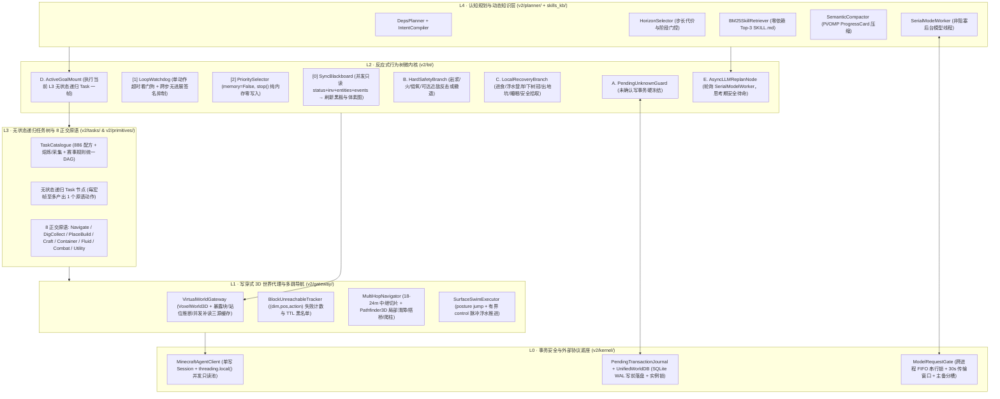

# BotSleep 2.0 重构总方案（经源码与上游 API 实证修订版）

> **基线与分支**：基于 `main` (`c6859dcaf7a23efe3794298cac082bb60b3efeb5`) 拉出 `develop-tianya/rewrite-v2`。
> **硬性前提**：相邻上游仓库 `mc-agent-api` 保持**绝对零本地源码修改**；一切虚拟化、缓存、多跳路由与容错均在 `BotSleep` 内闭环。

---

## 第零章 原方案审阅结论与 10 项关键工程修正（必读）

对原始草案（`botsleep_radical_refactoring_masterplan.md`）的总体审阅结论：**高度认同其宏观病灶诊断与五层正交化战略（约 80% 核心思想保留），但原草案第 3–7 章存在 10 处与 `mc-agent-api` 真实源码、`BotSleep` 现行实现及 `AGENTS.md` 硬性铁律直接冲突的工程谬误或安全隐患，若照搬落地将引发运行期崩溃或破坏事务不变量。** 本修订版已将全部谬误修正后固化为正式蓝图：

| # | 原草案观点 / 代码片段 | 实证核查真相（对照 `mc-agent-api/src/session.js` 与 `BotSleep`） | 本修订版正式修正方案 |
|---|---|---|---|
| **1** | 声称「`mc-agent-api` 存在 32 格 `move_to` 硬限制」，并在 `MultiHopNavigator` 传 `allow_partial=True, y=None`、读取 `status["position"]["x"]` | 1) 上游 `session.js:2124` 的 `move_to` **根本没有 32 格报错**，也**完全忽略 `allow_partial` 参数**（上游用 `GoalNear`/`GoalNearXZ`，受限于已加载区块、`thinkTimeout=15s`、`stallMs=8s` 以及 `m.canDig=false, scafoldingBlocks=[]`）；`Only local movement within 32 blocks is supported` 是 `BotSleep` 自身 `skills/survival.py` 的人工门禁。 2) 上游 `/status` 返回 `pos: [x, y, z]` 列表，**不存在** `position.x` 字典！ | 废除本地人工 32 格报错；`MultiHopNavigator` 对远距目标按 `18–24` 格切分中继航点，但**绝不盲发无脑 `GoalNearXZ`**——中近距结合 `VoxelWorld3D + Pathfinder3D` 自动识别需清障（树叶/竹子/1×2 岩壁）、搭桥、搭柱或水面游渡段，逐步推进并严格解析 `status["pos"]` |
| **2** | `FluidPrimitive` 声称调用 `use_item("bucket")`，`has_line_of_sight` 瞄准 `(tx+0.5, ty+0.5, tz+0.5)` 并放行 `water` / `short_grass` / `leaf_litter`，且读取 `result.type` | 1) 上游 `use_item` 仅限投掷物/食物/盾/弓；空桶与满桶**必须调用 `POST /interact {pos, item: "bucket"}`**（`session.js:2307` → `useBucket`）。 2) 上游 `useBucket` 空桶瞄准点是 **`(tx+0.5, ty+0.85, tz+0.5)`**，倒岩浆瞄准承载块顶面 **`(tx+0.5, ty-0.01, tz+0.5)`**；岸沿草丛或半格落差遮挡的是 `y+0.85` 射线。 3) `/get_block` 与 `/find_blocks` 字段名为 `name` 和 `pos: [x,y,z]`，**不存在** `type` 或 `b["x"]` | `FluidPrimitive` 严格走 `interact(pos, item)`，复用 `core/block_geometry._ray_cells` 精确对齐上游 `y+0.85` / `y-0.01` 瞄准点；若岸边站位被单格草/泥土遮挡视线，先由无状态子任务清障再装液 |
| **3** | 声称「发一次批量 `find_blocks` 即可补齐局部 5×5×5 体素（含空气）」，并设默认 `20s/30s` 盲信缓存 | 上游 `session.js:2017` 的 `find_blocks` **硬编码跳过 `air`/`cave_air`/`void_air`**，且**仅返回至少一面邻接空气/透明块的暴露方块**；无 `types` 时更只返回每类最近 1 个的统计摘要，绝不会返回完整 5×5×5 密集体素！ | L1 体素缓存采用三源融合：① `find_blocks(types=...)` 注入暴露实心/液体块；② 每次确认存活且未窒息的站位自动将脚部/头部记为 `INFERRED_PASSABLE`；③ 局部未知几何（如爬柱/岸边射线）通过 `AsyncReadPool` 并发 `get_block` 补齐并写穿缓存。**安全红线**：头顶/脚下重力块（砂砾/沙子）、流体邻域与未知写邻域在开挖前强制新鲜校验 |
| **4** | `Tick0` 用 `ThreadPoolExecutor(4)` 共享同一个 `requests.Session` 并发读取 | `requests.Session` 在连接重置重连（`close()` + 重建）时**非线程安全**（这正是原 `core/client.py:395` 特意隔离 `scan_blocks_detached` 的原因） | L0 客户端严格拆分为**单线程写动作 Session** 与 **`threading.local()` 只读连接池（每读线程独立长连接 Session）**，写动作绝不与后台读共享句柄 |
| **5** | `PrioritySelector` 抢占低优分支时调用 `child.stop(bb)`，未约束 `stop()` 的网络副作用 | 根据 `AGENTS.md` 硬约束：**「未知写入必须跨工作流传播，禁止通过新建 guard、换候选、返程或姿态清理追加动作」**。若叶子节点因 `action_unconfirmed` 挂起，`PendingUnknownGuard` 下一帧抢占时若 `stop()` 内发了 `posture(sneak=False)` 或 `client.stop()`，将直接违反未知写冻结铁律！ | 立法规定 **`Node.stop(bb)` 与 `Task.stop(bb)` 必须是 100% 纯内存状态复位，绝对禁止发起任何 HTTP 读写调用**；任何物理姿态复位（收盾、取消潜行）只能作为受 `PendingUnknownGuard` 门控保护的显式 BT 动作节点执行 |
| **6** | 照搬 AltoClef 20Hz `Task.tick()`，未处理受限 HTTP 动作的阻塞占锁与长工作流黑盒循环 | 上游 `mc-agent-api` 的 `move_to`/`dig`/`craft`/`window_act` 是耗时 `0.5s–60s` 的同步阻塞 HTTP（`locksAction=true`）。若把 `MineShaft` 或 `PortalCast` 写成内部循环 180 秒的巨型黑盒函数，期间行为树根本无法抢占 | 确立**「单写宏帧（Action-Boundary Macro-Tick）」契约**：每个叶子原语单次 `tick` **最多执行 1 次有界原子写动作**（配后台只读安全监控 `cancel_event` 与 `stop_on=["hurt","death"]`）；矿井、庇护所、地狱门全部改写为**基于世界状态自检的无状态递归 `Task`**（每帧只发出下一个缺失方块的单步动作，随即归还控制权给根行为树） |
| **7** | `LLMReplanBranch` 同步阻塞等待模型返回 | 实服 `qwen3.6-35b-a3b` / `deepseek-v4.1-flash` 单次耗时 `4.2s–7.5s`（排队时更长）；若同步阻塞 BT 主线程，Bot 将在野外罚站挨打致死 | 保留并提纯异步 `SerialModelWorker`：`LLMReplanBranch` 仅负责非阻塞投递请求与消费已完成提案；模型思考期间 BT 每 `0.5s` 照常运行 `Observe -> PendingGuard -> HardSafety -> LocalRecovery`，遇袭立即原地防御/撤退并使过期上下文提案失效 |
| **8** | 声称直接将赛事可执行覆盖率从 `13/99` 推至 `60+/99`，未区分条件项 `eligibility_overrides` | 按 `AGENTS.md` 与 `core/competition_rules.py`：`rules_v2.json` 含 **45 个无条件计分项 + 54 个条件计分项**；条件项无显式 `eligibility_overrides` 时**严禁纳入计分候选**，且蓝图打通不等于实服验收 | 保持 `CompetitionTasks` 的 5 个标准赛事工具名（`select_task` / `update_progress` / `finish_task` / `force_exit_task` / `end_competition`）与服务端 `/advancements` 唯一计分真值不变；在 `TaskCatalogue` 打通 `38+/45` 无条件项与 `25+/54` 条件项执行器（条件项仅在显式 override 开启时解锁选择） |
| **9** | 第五章要求删除根目录 `bot_sleep.py` 与 `client.py`，且重造 `ModelRequestGate` | 1) `AGENTS.md` 明确规定：「根目录 `bot_sleep.py`、`client.py` 是兼容入口，分别复用 `main.py` 和 `core/client.py`，不要再复制实现」。 2) 现仓 `core/model_gate.py` + `agent/brain.py` **已实现**主备双路由 `overflow_brain`、`TRANSPORT_WINDOW_SECONDS=30` 与 `scope_id`，`v25`–`v31` 实测 0 死锁 | **保留** `bot_sleep.py` 与 `client.py` 薄转发壳；**直接继承提纯**已实服验证 0 死锁的 `ModelRequestGate` 与 `OpenAIBrain` 双路由机制，不推翻重造文件锁协议 |
| **10** | 原草案第五章逐函数表存在大量脚本关键词误匹配（如把 `parse_args`、`build_parser`、`_java_tool` 映射为 `BM25SkillRetriever` 或 `PlaceAndBuildPrimitive`），且忽略了 `/events` 增量流 | 原草案第五章由脚本按函数名子串批量套模板生成，不可按字面执行；同时漏掉了 `mc-agent-api` 极高价值的 `GET /events?since=<seq>`（含精确伤害源 `source`/`source_entity`、死亡掉落坐标 `dropped_items_at`、拾取明细 `pickup`） | 废除原草案第五章机械套模板的函数映射，改为按**真实职责域**精确拆解重构（见本方案第五章）；在 `Tick0` `SyncBlackboard` 中正式纳入 `/events?since=seq` 游标增量流 |

---

## 第一章 现状核心病灶诊断（保留达成共识的四维归因）

在 `v24`–`v31` 连续 9-Bot 90 分钟实服压测（`difficulty=easy`、零作弊、官方未改 `mc-agent-api` 1.3.19）中，`v31` 达成了 `8/9` 烧铁、`7/9` 铁工具、`8/9` 进入 `nether_portal` 阶段、`0` 模型门禁死锁，但最终进入下界率仍为 **`0/9`**，累计消耗 **`20,372,954` tokens（输入 `20.18M` : 输出 `0.19M` ≈ `106:1`）**。当前 51,860 行非测试源码的核心瓶颈完全集中在四大结构性病灶：

1. **过程式状态机组合爆炸**：`skills/mining.py`（3,360 行）、`skills/portal_speedrun.py`（3,201 行）、`skills/survival.py`（2,613 行）、`core/autonomous_tasks.py`（2,431 行）、`core/survival_harness.py`（2,350 行）五个文件占全仓 27%，依靠手工阶段游标与跨模块标志位（`suspended` / `needs_ai` / `retreat_required` / `SOFT_POLICY_RELAXED` / `force_override`）穷举开放世界异常，修一处破两处。
2. **主循环与高阶资产「双轨分裂」**：仓库内已写好的 `VoxelWorld3D`（SQLite chunk-zlib 3D 体素记忆）、`Pathfinder3D`（3D A* + 搭桥/微掘寻路）、`WorldNavigator`、`RecipeBook`（886 配方 + `mc_tree_crafting.json`）、`CraftItemSkill`、`ContainerSkill`、`CaveExploreSkill` 游离于生存主循环之外；主循环仍在用窄表 `production_recipes.py`（69 项）、32 格人工移动限制与单点反复 `get_block`。
3. **106:1 上下文烧蚀与小模型注意力淹没**：巨型静态 `DAILY_SYSTEM_PROMPT` 叠加 48KB 字节硬裁剪，每轮平均向 35B/Flash 模型灌入 ~10,055 输入 tokens 换取 ~95 输出 tokens，`SKILL.md` 按需加载与 Pi/OMP 语义压缩仍停留在文档提案，导致模型在拿到 `iron_pickaxe` 后频频跑偏补铁斧/砍树，错失冲门窗口。
4. **2,185 项历史单测强耦合私有实现**：大量单测断言旧状态机的私有字典与内部方法调用序列，离线 2,185 全绿却拦不住实服 `v31` 的 64 格岩浆池 `out_of_range` 与坡岸 `target_occluded`。

### 重构三大铁律

1. **铁律一（死守四大护城河）**：严守 ① 写前原子 `pending` 落盘与 `unknown` 绝对冻结（不重放、不追加清理写动作）；② `ModelRequestGate` 跨进程串行与 30s 传输窗口契约；③ 真实库存/方块/服务端 `/advancements` 后验验收；④ 外部 `mc-agent-api` 零修改。
2. **铁律二（彻底终结双轨制与大状态机）**：用「反应式行为树 + 无状态递归任务树 + 写穿式 3D 世界网关」统一接管 `sleep` / `starter` / `daily` / `competition` 四种运行路径，彻底淘汰过程式步骤游标与重复技能实现。
3. **铁律三（代码减半、实服破局）**：保持极简运行依赖（标准库 + `requests` + `PyYAML`），核心源码从 ~5.18 万行收敛至 ~2.0–2.4 万行，单次模型输入压至 `<= 6.6KB`，打通单新档与 9-Bot 实服进下界闭环。

---

## 第二章 五大开源范式吸收与受限 HTTP 适配矩阵

| 来源范式 | 吸收的核心工程机制 | 面向 `mc-agent-api` 阻塞式 HTTP 的关键改造 | `v2` 落点模块 |
|---|---|---|---|
| **AltoClef** | 「20 Questions」无状态递归 `Task.on_tick()` + `TaskCatalogue` DAG + `BlockTracker` 不可达拉黑 + Target Commitment + `avoid_block_breaking` 保护谓词 | 将 20Hz 客户端帧改为**「单写宏帧（每次最多发出 1 个有界原子写动作后回到根树重评估）」**；`unreachable` 按 `(dim, pos, action)` 带 TTL 存入本地世界库 | `v2/tasks/base.py`、`v2/tasks/catalogue.py`、`v2/gateway/unreachable.py` |
| **py_trees** | `PrioritySelector(memory=False)` 反应式抢占 + 命名空间共享 `Blackboard` + `ActivityStream` 读写追踪 | `Tick0` 通过线程安全只读池一次性拉取 `status` + `inventory` + `entities` + `events` 写入黑板；**立法规定 `stop(bb)` 纯内存零网络写入** | `v2/bt/kernel.py`、`v2/bt/blackboard.py`、`v2/bt/runtime.py` |
| **MC-Planner (DEPS)** | `Describe → Explain → Plan → Select` 结构化失败归因 + `HorizonSelector` 步长代价排序 | `NEEDS_AI` 时本地生成 3–5 行几何/资源根因诊断与可行替代路径；速通门控就绪（如持铁镐/4 铁）时置顶下界门候选 | `v2/planner/deps_explainer.py`、`v2/planner/horizon_selector.py` |
| **Voyager** | 高内聚动作原语 + `ExploreUntilTask(predicate)` 通用条件终止探索 | 摒弃 `eval` 与作弊指令；在原语层内部消化岸边视线站位求解、工作台复用与多跳接近，全部经由 L0 事务门禁执行 | `v2/primitives/*`、`v2/tasks/explore.py` |
| **GITM + Mindcraft + Pi/OMP** | 正交动作集 + 递归子目标树 + 零依赖本地 BM25 `SKILL.md` 动态召回 + 语义 `ProgressCard` 压缩 | 将巨型 Prompt 拆为 15–20 张 300–500 字 `skills_kb/*.md` 微卡，每轮仅注入 Top-3；保留最近 2 组完整 `tool_call/result` 并将旧轮次折叠为结构化 `ProgressCard` | `v2/planner/skill_retriever.py`、`v2/planner/compactor.py`、`skills_kb/*.md` |

---

## 第三章 BotSleep 2.0 五层微内核目标架构（L0–L4）

严格实行自上而下的**单向依赖法则**：`L4 (planner) -> L3 (tasks & primitives) -> L2 (bt) -> L1 (gateway) -> L0 (kernel)`。低层绝对禁止反向 `import` 高层模块（由 `tests_v2/test_00_layer_boundaries.py` AST 静态门禁强制守护）。

---

## 第四章 关键模块精确接口契约（已修正协议与几何细节）

### 4.1 L0 客户端并发读隔离与统一事务库（`v2/kernel/`）

1. **`MinecraftAgentClient` 双通道隔离**：
   - **写通道（Action Channel）**：独占单一 `requests.Session`，仅允许主循环在通过 `PendingTransactionJournal.begin_write()` 落盘后串行调用 `WRITE_ENDPOINTS`（`move_to`, `dig`, `place`, `craft`, `interact`, `use_item`, `equip`, `window/view`, `window/act`, `attack`, `shoot`, `control`, `posture`, `look`, `drop`, `chat`）。遇到超时、连接断开或 `not_connected` 一律标记 `action_state="unknown"`。
   - **只读池（`AsyncReadPool`）**：基于 `threading.local()` 为每个只读工作线程维护独立 `requests.Session`（`127.0.0.1` keep-alive），绝不关闭或篡改写通道 Session。支持：
     - `observe_tick_bundle(last_event_seq)`：并发拉取 `GET /status`、`GET /inventory`、`POST /get_entities(radius=32)`、`GET /events?since=last_event_seq`（1 次 RTT 内完成整帧感知）。
     - `batch_get_blocks(coords, max_workers=4)`：针对本地体素缓存未命中的少量关键几何格（如岸边视线射线、头顶砂砾检查、爬柱净空）并发调用 `POST /get_block`（本机 worker 单次 ~1ms）。
2. **`UnifiedWorldDB` + `PendingTransactionJournal`（SQLite WAL）**：
   - 按 `(api_base_url, username, world_id)` 隔离单一 SQLite 库（`PRAGMA journal_mode=WAL; PRAGMA synchronous=NORMAL; PRAGMA busy_timeout=5000;`），彻底取代 `data/game_logic/*.json` 与零散临时文件替换，消除 Windows `WinError 5` 与并发 JSON 解析崩溃。
   - 表结构：`meta`、`pending_tx`（最多 1 条未决写事务，含 `life_marker`、`dim`、`pos`、`endpoint`、`payload_digest`、`started_at`、`state`）、`voxel_chunks`（复用 `VoxelWorld3D` `chunk-zlib`）、`landmarks`（熔炉、工作台、庇护所、地表岩浆池、水源、矿井入口、死亡掉落点）、`unreachable_blocks`、`checkpoints`（含 `competition` 状态快照与 `ProgressCard`）。

### 4.2 L1 写穿式世界代理与精确射线/多跳导航（`v2/gateway/`）

1. **三源体素融合与安全新鲜度分级（`VirtualWorldGateway`）**：
   - 严格解析 `mc-agent-api` 真实格式：`block["name"]`、`block["pos"] = [x, y, z]`、`block["properties"]`。
   - **写入源**：
     - `EXACT`：`get_block` 精确返回，以及确认成功的 `dig`（写为 `air`）和 `place`（写为目标方块名）。
     - `SCAN`：带 `types` 的 `find_blocks` 返回的暴露方块列表。
     - `INFERRED_PASSABLE`：当 `status.alive` 且未窒息时，自动标记脚部 `floor(pos)` 与眼部所在格可通行。
   - **失效策略**：任何 `action_state == "unknown"` 的写操作立即清除目标周围 `3×3×3` 缓存并标为 `MUST_REVERIFY`；挖掘头顶/脚下或邻近液体前，若邻格含重力块（`sand`/`red_sand`/`gravel`）或流体，或缓存年龄超过短安全阈值（`3.0s`），强制回源 `get_block`。
2. **与上游 `useBucket` 100% 对齐的液体视线求解器**：
   - 空桶取水/取岩浆：目标点固定为 `[tx + 0.5, ty + 0.85, tz + 0.5]`，要求 `status.pos` 距源方块 `<= 2.9`、眼距瞄准点 `<= 4.5`、源方块 `properties.level == "0"`。
   - 满桶倒液（浇筑门框/受控坑）：点击承载实心块顶面 `[tx + 0.5, ty - 0.01, tz + 0.5]`。
   - 在本地 `VoxelWorld3D`（缺失格经 `batch_get_blocks` 一次性补齐）枚举液体周围 `r ∈ [1.2, 2.8]` 的实心安全站位，使用 `core/block_geometry._ray_cells` 检查射线内全部经过格是否为纯 `AIR`；若唯一阻挡物是可安全挖掘的岸边草/花/雪/单格泥土，返回 `ClearOccluderStep(blocker_pos)` 先清障再装液；连续 2 次失败记入 `BlockUnreachableTracker`。
3. **两级多跳导航器（`MultiHopNavigator` + `SurfaceSwimExecutor`）**：
   - **彻底废除本地 32 格报错**：上层统一调用 `navigate_step(bb, gw, target_pos, tolerance)`，每次调用仅执行 **1 跳有界动作**，返回 `REACHED | PROGRESSED | BLOCKED | NEEDS_SUBTASK`。
   - **远距（`dist > 22m`）**：沿目标方向在 `18–22m` 处选取中继目标。若本地体素图显示前方存在水域，切入 `SurfaceSwimExecutor`（`posture(jump=True)` + `control(forward=True, jump=True, yaw=..., ms=450)` 浮水推进，实时监控 `submerged`/`oxygen`）；若陆路畅通，下发 `move_to(x, z, timeout_ms=8000, range=2)`。
   - **近距或受阻（`dist <= 22m` 或上一跳 `stalled`/`path_not_found`）**：调用 `Pathfinder3D` 在局部体素图规划 3D A* 步序（支持清树叶/竹子/1×2 软岩、单格垫脚爬升、跨沟锚定搭桥，并通过 `avoid_block_breaking` 保护庇护所/工作站/门框），每次执行一步并校验净位移 `>= 0.35m`；连续 2 次无进展立即标记阻塞边 `record_blocked_edge` 并换向绕行。

### 4.3 L2 反应式行为树微内核（`v2/bt/`）

- **纯内存 `stop(bb)` 铁律**：`PrioritySelector` 在高优节点返回 `RUNNING`/`SUCCESS` 时，对先前运行的低优节点调用 `stop(bb)`。`stop(bb)` 仅清空本地游标/子任务引用，**严禁调用 `client` 任何方法**。
- **树冠与密封坑「不可达地面怪豁免」**：在 `HardSafetyBranch` 中整合 `v22`/`v31` 实战经验——当玩家位于密封 `night_burrow` 内或高树冠（与地面近战怪高度差 `|dy| >= 3` 且无直通阶梯），地面僵尸/蜘蛛不再无限抢占 `CanopyDescend` 或原地制作，仅在远程怪（骷髅/掠夺者）具备无遮挡射界或实际受到 `hurt` 事件时触发避险。
- **全模式统一调度**：
  - `--mode sleep`：挂载精简树 `Observe -> PendingGuard -> HardSafety -> AutoSleepBranch`。
  - `--mode survival --objective starter|daily|competition`：挂载完整树，差异仅在于 `ActiveGoalMount` 缺省目标源与 `L4` 暴露的顶层工具集。

### 4.4 L3 无状态递归任务树与单写宏帧（`v2/tasks/` & `v2/primitives/`）

- **单写宏帧契约**：`Task.tick(bb)` 自顶向下递归调用 `on_tick(bb)` 定位到当前最底层缺失前置（叶子 `PrimitiveTask`），执行 **1 次** 原子原语调用后立即返回 `RUNNING | COMPLETED | FAILED_LOCAL | NEEDS_AI`。下一帧从 `Tick0` 重新观测、重新走安全门禁、重新自顶向下问答，天然具备任意中断后的无损自愈能力。
- **8 个正交原语**：
  1. `NavigatePrimitive`（多跳陆行、3D 微掘/搭桥/爬柱、水面游渡）
  2. `DigCollectPrimitive`（采木、采矿、挖砂砾刷燧石、清叶清障、余矿挖净与掉落拾取确认）
  3. `PlaceBuildPrimitive`（工作站放置、四朝向 `StructureSpec` 庇护所单步补块、床/双半门放置与开关）
  4. `CraftPrimitive`（统一接入 886 配方 `RecipeBook` + `mc_tree_crafting.json`，自动识别 2×2 手合与 16 格内已有工作台复用，严禁重复制造工作台）
  5. `ContainerPrimitive`（2–3 炉并行批炼投料/整批收取、双箱存取、战利品箱搜刮）
  6. `FluidPrimitive`（`y+0.85` 视线校验装水/装岩浆、门框分步浇筑、受限容纳坑回收）
  7. `CombatPrimitive`（近战短步反击、举盾/安全收盾、弓弩射击、被动动物狩猎）
  8. `UtilityPrimitive`（进食、`EquipmentSkill` 护甲/副手盾最优穿戴、入睡/起床、满包丢弃低值杂物、`EyeObservationCollector` 投眼采样）

### 4.5 L4 DEPS 规划、动态 `SKILL.md` 与赛事兼容层（`v2/planner/`）

- **6.6KB 严格单请求预算**：
  - 基础 System Prompt `<= 1,500 B`（仅保留角色契约与安全红线）。
  - `BM25SkillRetriever` 从 `skills_kb/*.md` 按黑板状态标签 + 词频召回 Top-3 卡片 `<= 1,500 B`。
  - 当前世界紧凑快照 + `HorizonSelector` Top-5 候选及预计步长 `<= 1,200 B`。
  - `SemanticCompactor`（Pi/OMP 风格 `ProgressCard` + 最近 2 组完整 `tool_call/tool_result` 配对 + `DepsExplainer` 3 行失败归因）`<= 1,200 B`。
  - 动态工具 Schema `<= 1,200 B`：
    - `daily` 正常态仅暴露高层目标工具（`run_goal`, `run_macro`, `wait`）；进入 `NEEDS_AI` 才临时挂载对应局部修复原语。
    - `competition` 严格保留 `select_task`, `update_progress`, `finish_task`, `force_exit_task`, `end_competition` 五个标准赛事生命周期工具，计分唯一依据仍是 `CompetitionTasks` 核验的新鲜 `/advancements` 响应，条件项仍须显式 `eligibility_overrides` 才可选择。

---

## 第五章 现仓 111 个源码文件按职责域精确处置映射

摒弃原草案机械正则映射，按真实工程价值将全仓归入五类明确动作：

1. **直接提纯迁入 L0/L1/L2 核心资产（零推翻重造）**：
   - `core/config.py` → `v2/kernel/config.py`（保留 YAML/环境变量/CLI 覆盖契约）。
   - `core/client.py` → `v2/kernel/client.py`（保留全部端点与超时/错误归一化，新增 `AsyncReadPool` 线程本地 Session；根目录 `client.py` 保持兼容薄转发）。
   - `core/model_gate.py` + `agent/brain.py` + `core/model_worker.py` → `v2/kernel/model_gate.py` + `v2/planner/llm_client.py` + `v2/planner/model_worker.py`（完整保留 TLS1.2 适配、30s 传输窗口、FIFO 文件锁与主备双路由 `overflow_brain`）。
   - `core/world_3d.py` + `core/pathfinder_3d.py` + `core/cave_probe.py` + `core/block_geometry.py` → `v2/gateway/`（正式扶正为主循环唯一 3D 空间底座）。
   - `core/safety_arbiter.py` + `core/loop_supervisor.py` → `v2/bt/branches/hard_safety.py` + `v2/bt/watchdog.py`。
   - `core/recipes.py` + `core/mining_targets.py` + `core/structure_spec.py` → `v2/tasks/catalogue.py` + `v2/tasks/mining.py` + `v2/tasks/shelter.py`。
   - `core/competition_rules.py` + `core/competition_tasks.py` + `core/competition_blueprints.py` → `v2/tasks/competition/`（保留严格 `/advancements` 计分与 `eligibility_overrides` 契约，将已完成 DAG 对接的新成就从 `unsupported` 升级为可执行）。
   - `integrations/ninjabrain/*` → 原位保留并通过 `UtilityPrimitive` / `StrongholdTask` 受控接入。
   - `debug/logger.py` + `debug/monitor.py` + `debug/monitor_tail.py` + `debug/chat_debugger.py` → `v2/observability/`（监控面板新增 BT 激活路径、缓存命中率、Token 读写比）。
   - `bot_sleep.py` + `client.py` + `scripts/botctl.py` + `scripts/multi_bot_runner.py` + `scripts/import_mc_tree.py` → **保留兼容入口与运维压测工具链**。

2. **整合提炼为 8 个正交原语与无状态 `Task`（消除双轨重复）**：
   - `skills/crafting.py` + `skills/survival.py(_craft)` + `core/production_recipes.py` → 统一为 `v2/primitives/craft.py` + `TaskCatalogue`（删除窄表 `production_recipes.py`）。
   - `skills/container.py` + `skills/daily_survival.py(熔炉/箱子)` → 统一为 `v2/primitives/container.py` + `SmeltItemTask`（支持多炉并行）。
   - `skills/buckets.py` + `skills/portal_speedrun.py` → 提炼为 `v2/primitives/fluid.py` + `v2/tasks/nether_portal.py`（单步状态驱动浇筑与点火）。
   - `skills/combat.py` + `skills/hunting.py` → 统一为 `v2/primitives/combat.py`。
   - `skills/equipment.py` + `skills/sleep.py` → 统一为 `v2/primitives/utility.py`。
   - `skills/mining.py` + `skills/ore_harvester.py` + `skills/cave_explore.py` + `core/starter_mining_task.py` → 提炼为 `v2/primitives/dig_collect.py` + `v2/tasks/mining.py` + `v2/tasks/cave_explore.py`。
   - `skills/world_navigator.py` + `skills/movement.py` + `skills/positioning.py` + `skills/scouting.py` → 统一为 `v2/gateway/multihop_navigator.py` + `v2/primitives/navigate.py` + `v2/tasks/explore.py`。

3. **在切流完成后退役归档的旧耦合层**：
   - `core/autonomous_tasks.py`、`core/autonomy_runtime.py`、`core/survival_harness.py`、`core/local_recovery_runtime.py`、`core/retreat_controller.py`、`core/daily_policy.py`、`agent/daily_survival.py`、`agent/survival_planner.py`、`agent/loop.py`、`core/memory.py`、`skills/exploration.py` 以及庇护所/树叶局部路线系列小补丁（`night_home_route.py`、`shelter_approach.py`、`shelter_return.py`、`shelter_route_recovery.py`、`route_foliage_recovery.py`、`skills/batch_tasks.py`）。

---

## 第六章 新测试金字塔与验收门禁（区分离线仿真与实服真值）

遵循 `AGENTS.md`「必须区分协议/离线测试通过、真实技能成功和完整生存目标完成」的准则，建立三层验证体系：

1. **Tier 1 · 架构边界与安全不变量单测（`tests_v2/invariants/`）**：
   - AST 静态层间单向依赖检查（严禁低层逆向导入高层、严禁 L2/L3/L4 绕过 L1 私调裸客户端）。
   - `PendingTransactionJournal` 断连/超时冻结不重放测试 + `PrioritySelector` 抢占时 `stop(bb)` 零网络写验证。
   - `ModelRequestGate` 跨线程/跨进程并发=1、30s 传输恢复窗口与主备溢出隔离测试。
2. **Tier 2 · 纯内存 3D 虚拟 `mc-agent-api` 仿真回归（`tests_v2/sim/`）**：
   - 搭建遵守真实 `mc-agent-api` 语义的内存假服务端（模拟暴露块扫描跳过空气、`useBucket` `y+0.85` 射线遮挡、`m.canDig=false` 寻路受阻、`hurt` 打断与重力方块），离线毫秒级跑通：
     - 64 格岩浆池多跳导航 + 浇筑点火进下界（复现并验证 `v31` `bot_3` 场景）；
     - 落差水岸清障取水（复现并验证 `v31` `bot_1`/`bot_6` `target_occluded` 场景）；
     - `y=43` 深坑低读耗脱困返表与树冠不可达地面怪豁免下树（复现并验证 `v30` `bot_1`/`bot_2`/`bot_5` 场景）。
3. **Tier 3 · 专用世界实服冒烟与 9-Bot 基准（需显式开启，不混同离线通过）**：
   - 单 Bot Easy 实服「空手出生 → 铁镐 + 水桶 + 打火石 → 进下界」端到端验收；
   - 9-Bot 90 分钟 Easy 分散出生压测：目标进下界率 `>= 6/9`、总 Token `<= 7.0M`（输入/输出比 `<= 35:1`）、单步平均只读 HTTP `<= 4` 次、`0` 模型死锁、`0` 未知写重放。
