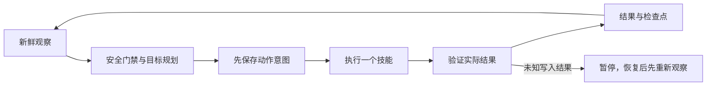

# 生存与 harness

`survival.objective: starter` 保留下面的初期工具链；`daily` 接通日常生存任务板、分层记忆、食物/铁器/熔炼/床/住所/储物/死亡掉落恢复与持续维护，见 [DAILY_SURVIVAL.md](DAILY_SURVIVAL.md)。模型与规则模式共用已验证技能，但模型模式不会在请求失败时偷偷切换规则采集。单模型请求槽跨进程持久化；未知模型请求与未知游戏动作分别恢复。

```powershell
python -B main.py --config config.yaml --mode survival --objective daily
```

游戏动作的 `dig_unconfirmed` / `action_unconfirmed` 等未知结果保留 pending，不重放；`--resume` 只授权重新观察。模型 `llm_request_uncertain` 表示服务端可能仍在处理，后续请求会被锁住（重启也不会清除），日常模式仍执行本地安全检查。只有确认服务端已结束该请求，才使用 `--acknowledge-model-idle` 恢复模型槽，不能把这个参数当作自动重试开关。模型等待期间检测到危险，丢弃迟到提案并处理本地避险；不声称取消 HTTP 已终止远端推理。

初期目标：空背包采木，合成木板、木棍、工作台并放置，制作木镐，采集圆石，最终具备石镐、石斧、石剑和熔炉。更高级对应工具及附近已有熔炉也满足目标；已有煤/木炭和木棍时可制作火把。

## 模块

| 模块 | 职责 |
|---|---|
| `core/config.py` | 模式、观察/重试/探索/时间/步骤/死亡限制，离线校验 |
| `core/survival_state.py` | 新鲜状态/背包/方块/实体采样，死亡或维度变化时丢弃跨状态快照；原子检查点与事件 |
| `agent/survival_planner.py` | 从当前库存推导下一步缺失材料；每次只选一个动作，历史里程碑不代替现有物品 |
| `agent/llm_planner.py`、`agent/brain.py`、`agent/tools.py` | 可选原生工具调用、严格参数校验、有界历史与修复、真实技能结果反馈 |
| `skills/survival.py` | 参数白名单、前置复查和动作后验证 |
| `core/survival_harness.py` | 单 worker、意图持久化、技能分派、反馈、安全中断、恢复和预算 |
| `debug/chat_debugger.py` | 可信玩家的 stop/resume/sleep/status；默认名单为空 |
| `debug/logger.py`、`debug/monitor.py` | 脱敏 JSONL 与本机只读事件监控 |



优先检查存活/就绪/互斥、主世界生存模式、环境危险和脚下稳定性、附近敌对实体、已有食物/低血量、睡眠，然后推进工具链。主线程在非紧急技能期间也查询状态，危险时请求停止，待当前请求结束后重新决策。没有可靠脱困路线的岩浆、着火、溺水只会等待，不声称具有实时救援能力。

## 模型模式与反馈

`agent.mode: survival` 与 `llm.enabled: true` 同时开启时使用模型规划；否则生存模式使用确定性规划器。模型服务需兼容 Chat Completions 原生函数工具调用。每轮发送当前状态、库存、已观察资源/实体、预算及压缩后的历史，按完整工具调用/结果事务裁剪，只允许一个已注册工具；文本中的伪工具调用不会执行。

模型返回后重新采样，生命、维度或安全条件变化会拒绝旧动作。目标和参数还需通过本地技能检查；实际 `SkillResult` 与后续观察以相同 `tool_call_id` 反馈，失败、部分完成和观测过时均明确保留。`goal_complete` 必须由新鲜库存核验初期目标。非法输出按 `llm.max_repair_attempts` 有界修复，不执行任意代码或动态技能。

地形类型摘要并非完整可通行地图。模型模式额外采样附近站位和放置候选（各最多8项），并用原版 `get_block` 对少量近处资源做保守体素视线检查；站位扫描最多60次读取，资源检查另有96次读取预算。视线把未知碰撞形状当作遮挡，预算不足或区块未加载则保留未知，不修改 API。距离接近不证明路径可用；移动达到范围也不证明已经脱困。模型能发出合法调用不代表采集/制作成功，仍须以方块和库存变化验收。

完整收到 HTTP 408/425/429 和 5xx 后可退避重试，使用 `survival.retry_seconds` 为基数，上限 60 秒，仍消耗步骤和时间预算。模型传输超时/网络中断改为持久化 `llm_request_uncertain`，不能自动重发；日常模式锁住模型后继续本地安全行为，初期模式暂停。其他 HTTP 错误（例如 401）直接暂停，模型故障不回退到确定性资源采集。`--once` 只返回该次尝试的结果。

`debug.monitor.enabled: true` 启用默认 `127.0.0.1:18930` 只读页面，展示阶段、暂停原因、技能结果与脱敏请求/响应（含服务实际提供的工具调用、附带推理、token 和耗时）。请求路由取 `llm.model`；实际模型标识仅取 `LLM_RESPONSE.data.response.model`，缺失显示“未确认”，不能用 `default` 等路由名补齐。该标识由服务自报。页面最近事件有数量/体积上限，完整运行日志由 FlightRecorder 持久化。

mc-agent-api 1.3.7 的 `speed`（水平）与 `velocity`（三轴）会进入模型快照，监控显示水平和垂直速度，单位为格/秒。旧 API 缺失字段及新版返回 `null` 均表示未知，不补成零；异常数值会被过滤。单次速度为零不能作为卡住或到达的唯一依据，仍验证真实位置和状态。

## 技能契约

`SurvivalSkills(client).execute(name, args, cancel_event=None, *, recovery_context=None) -> SkillResult`。多余/缺失参数、非有限数值、未知技能均明确失败，不动态执行任意函数。`recovery_context` 仅供 harness 为撤退传入失败落点、初始位置与分段状态，不开放为模型工具参数。

| 技能 | 参数 | 成功证据 |
|---|---|---|
| gather_block | pos, expected_name | 目标方块消失且预期物品净增 |
| craft_item | item, count=1（净增量1–64） | 背包净增加至少请求量；部分完成单独报告 |
| place_item | item, pos | 方块匹配且库存减少 |
| eat_food | item | 饥饿值增加且食物减少 |
| move_to | pos, range=2 | 最终位置进入容差，维度未改变 |
| retreat_from | 威胁pos, distance=8 | 先找到完整实地路线，每次只走一个相邻落点；核验脚格、落地和支撑，区分树冠中继与实地完成 |
| auto_sleep | 沿用sleep配置 | 已有睡眠状态机的入睡/醒来证据 |

采集仅允许木石煤，不挖自身上下同列，不碰液体/火邻接；石煤需镐。放置需空位、支撑和基础方块白名单。撤退针对采样时的威胁坐标，底层 API 寻路不能保证逐格沿检查路线，怪物也可能移动。

撤退采用四邻接台阶搜索，最多上升一格、下降两格，检查身体与跳跃/下降扫过的净空。搜索最多8步、水平半径8格、64个已确认站位，总方块读取上限256次，包含动作前后落点复核。身体空间允许空气、短草与落叶；明确未水浸的已知树叶可作临时支撑，但必须先找到符合坚实支撑白名单的完整路线。不会仅因存在一块相邻树叶就盲走。

API 将位置保留一位小数，角色也可能以碰撞箱边缘站在邻格上。仅在 `on_ground=true`、中心脚下已加载且为空气时，才检查邻格支撑：按位置 ±0.05 的精度误差和半宽0.3001，要求所有可能真实位置都与该支撑有正面积重叠，并检查移向其中心的整个保守身体扫掠范围。未知支撑、净空被挡或过于接近敌人均拒绝；先有完整实地路线才执行首段接入。发送移动前的最后一次状态读取再次核对起点、落地和接触范围；`edge_start`/`origin_support` 保存判断依据。

远离威胁采用水平距离衡量，允许安全下降导致三维距离变小；进入敌人近身高度时另行限制水平接近。规划期间跨格、明显升降或不再落地均拒绝执行。每次只向路线上的下一个相邻脚格发送一次 `range=0` 移动，随后核验实际脚格、落地和支撑，下一轮重新观察、重新规划。`evacuation_stage=relay` 与 `retreat_complete=false` 只表示中途进展；到达实地且相对本次撤退初始位置水平远离至少2格才标记 `ground`/完成，近敌仍由下一轮安全门禁检查。

`planned_path` 是候选地形证据，不是可重放指令；`path_following_verified=false` 表示没有证明底层实际轨迹完全一致。没有合适路线仍失败，并给出最多4个阻挡格、读取和节点预算诊断。harness 按实际失败落点冷却排除（最多8个），中继后即使敌人暂时超出触发半径仍继续验证到实地；死亡或维度变化会清除这段撤退状态。无路时每5秒重新观察，相同场景最多每30秒重搜，位置、威胁或已观察阻挡变化可提前重搜；不再通过相同无路失败耗尽普通连续失败次数，仍受总步骤、时间和死亡预算限制。未知动作结果继续暂停并保留 pending，不自动换路线重发。

近敌和撤退中继使用两秒总预算的短安全观察（状态、实体、状态），保留生命、维度、位置和忙态一致性检查，跳过完整生产扫描。短观察只授权本地撤退或等待；每段地形仍由技能重新验证，成功中继后不再额外等待轮询间隔。未读取的库存标记未知，不更新库存记忆或生产里程碑；监控把旧任务板标为待复核，配对模型反馈使用 `counts=null`。完整观察恢复后才允许模型生产决策。无近敌的低血/饥饿仍读取真实库存以维持进食优先，未就绪或死亡的空坐标进入正常等待。

### 未确认挖掘的复核

官方 API 1.3.6 起在未收到服务端方块更新时返回 `dig_unconfirmed`，并可能把客户端缓存恢复为原方块。因此“查询仍是原方块”不能证明服务端没有执行。

BotSleep 只发送一次挖掘，收到该码后请求停止；在 2 秒复核预算内最多读取 3 轮状态、库存和目标方块，逐请求使用剩余超时，并检查取消、死亡和维度变化：

- 方块移除且预期库存净增：以实际证据报告成功，保留 `recovered_from=dig_unconfirmed` 和 API 诊断。
- 明确移除但库存未增：报告 `gather_unverified`，有剩余预算时查询匹配掉落物；反馈不可再次挖同一目标。
- 缓存仍为原方块、必要读取失败、停止失败、取消或预算耗尽：保留 `dig_unconfirmed` 和 `action_state=unknown`，暂停并保存 pending，不自动重发。

复核预算约束恢复阶段的读取和等待，不含原 API 挖掘请求的执行时间；同步 HTTP 的实际结束仍受连接、读取超时语义影响。恢复结果及原始距离、落地和延迟诊断会随技能反馈进入日志和模型历史。

## 持久化和恢复

- 检查点按 API 地址、账号和 world_id 隔离。换世界必须更改 world_id；API 不提供真实存档身份。不会写入受版本控制的 data/game_logic。
- 动作前写 pending；重启发现 pending 则暂停。恢复时只读新状态重新计划，后台 busy 时连手动睡眠也不覆盖旧 pending。
- 动作阶段的请求超时、网络/响应解码错误和内部验证异常暂停并保留意图，不自动重发。
- 未能复核的 `dig_unconfirmed` 同样保留意图并暂停；已经验证的延迟成功或明确移除未拾取按对应证据处理。
- 普通失败指数退避（上限60秒），重复目标进入冷却，连续失败暂停；探索、步骤、运行时间和死亡次数均受限。
- 死亡清除旧出生点、目标冷却、撤退状态和探索序号，按新鲜库存重新规划；延迟 last_death 不重复计数。不自动取回死亡掉落。暂停或退避时每5秒仍以只读状态检查生命周期，不伪造库存，不解除手动或未知结果暂停。
- 断线仅复用 token 调用 connect，不重复登录绕过后端死亡循环保护。
- 总时间到达请求取消，不能即时打断同步 HTTP；退出仍等请求结束。dig HTTP预算约135秒，craft约420秒，总时间不是强杀进程期限。

持续模式目标完成退出0，预算耗尽退出2；--once仅做一次决策，成功或等待退出0不等于整个目标完成。暂停会保持连接等调试恢复，但总运行时间仍有效。

检查现场后，可由可信玩家发送 `#resume`，或在启动时显式使用 `python main.py --config config.yaml --mode survival --resume`。两者都重新读取状态并规划，不重放保存的动作。默认启动保留 pending 暂停；`--once` 也不能隐式绕过它，需要同时给出 `--resume`。该参数不用于睡眠模式。

## 尚未实现

食物采集/农业、动物狩猎/战斗、熔炼、羊毛与床制作、安全住所、长期基地、跨维度、后续科技树和通关均未完成。无床夜晚、严重饥饿会等待。动态技能生成、搭高、落地水和高频反射未接通；确定性规划与模型规划共用当前有限技能集。

API 无法辨别玩家放置与自然生成的方块，不能判断所有权。开发验证使用独立场地；不可把简单场地通过当成天然地图长期生存通过。
