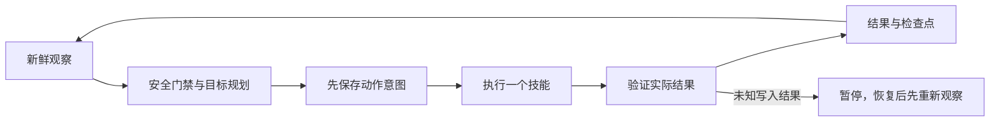

# 初期生存与 harness

当前目标：空背包采木，合成木板、木棍、工作台并放置，制作木镐，采集圆石，最终具备石镐、石斧、石剑和熔炉。更高级对应工具及附近已有熔炉也满足目标；已有煤/木炭和木棍时可制作火把。

## 模块

| 模块 | 职责 |
|---|---|
| `core/config.py` | 模式、观察/重试/探索/时间/步骤/死亡限制，离线校验 |
| `core/survival_state.py` | 新鲜状态/背包/方块/实体采样，死亡或维度变化时丢弃跨状态快照；原子检查点与事件 |
| `agent/survival_planner.py` | 从当前库存推导下一步缺失材料；每次只选一个动作，历史里程碑不代替现有物品 |
| `agent/llm_planner.py`、`agent/brain.py`、`agent/tools.py` | 可选原生工具调用、严格参数校验、有界历史与修复、真实技能结果反馈 |
| `skills/survival.py` | 参数白名单、前置复查和动作后验证 |
| `core/survival_harness.py` | 单 worker、意图持久化、技能分派、反馈、安全中断、恢复和预算 |
| `debug/chat_debugger.py` | 可信玩家的 stop/resume/sleep/status；默认名单为空 |
| `debug/logger.py`、`debug/monitor.py` | 脱敏 JSONL 与本机只读事件监控 |

优先检查存活/就绪/互斥、主世界生存模式、环境危险和脚下稳定性、附近敌对实体、已有食物/低血量、睡眠，然后推进工具链。主线程在非紧急技能期间也查询状态，危险时请求停止，待当前请求结束后重新决策。没有可靠脱困路线的岩浆、着火、溺水只会等待，不声称具有实时救援能力。

## 模型模式与反馈

`agent.mode: survival` 与 `llm.enabled: true` 同时开启时使用模型规划；否则生存模式使用确定性规划器。模型服务需兼容 Chat Completions 原生函数工具调用。每轮发送当前状态、库存、已观察资源/实体、预算及完整的工具调用/结果历史，只允许一个已注册工具；文本中的伪工具调用不会执行。

模型返回后重新采样，生命、维度或安全条件变化会拒绝旧动作。目标和参数还需通过本地技能检查；实际 `SkillResult` 与后续观察以相同 `tool_call_id` 反馈，失败、部分完成和观测过时均明确保留。`goal_complete` 必须由新鲜库存核验初期目标。非法输出按 `llm.max_repair_attempts` 有界修复，不执行任意代码或动态技能。

地形观察目前是最近暴露方块的类型摘要，并非完整可通行地图。距离接近不证明视线、路径或落脚点可用；移动达到范围也不证明已经脱困。模型能发出合法调用不代表采集/制作成功，仍须以方块和库存变化验收。

持续模式的模型超时、网络错误、HTTP 408/425/429 和 5xx 会退避重试，使用 `survival.retry_seconds` 为基数，上限 60 秒，仍消耗步骤和时间预算；这类瞬时错误不因普通连续失败阈值而永久暂停。其他 HTTP 错误（例如 401）直接暂停，模型故障不回退到确定性资源采集。本地安全门禁仍可选择等待、进食、避险或睡眠。`--once` 仍只返回该次尝试的结果。

`debug.monitor.enabled: true` 启用默认 `127.0.0.1:18930` 只读页面，展示阶段、暂停原因、技能结果与脱敏请求/响应（含服务实际提供的工具调用、附带推理、token 和耗时）。请求路由取 `llm.model`；实际模型标识仅取 `LLM_RESPONSE.data.response.model`，缺失显示“未确认”，不能用 `default` 等路由名补齐。该标识由服务自报。页面最近事件有数量/体积上限，完整运行日志由 FlightRecorder 持久化。

## 技能契约

`SurvivalSkills(client).execute(name, args, cancel_event=None) -> SkillResult`。多余/缺失参数、非有限数值、未知技能均明确失败，不动态执行任意函数。

| 技能 | 参数 | 成功证据 |
|---|---|---|
| gather_block | pos, expected_name | 目标方块消失且预期物品净增 |
| craft_item | item, count=1（净增量1–64） | 背包净增加至少请求量；部分完成单独报告 |
| place_item | item, pos | 方块匹配且库存减少 |
| eat_food | item | 饥饿值增加且食物减少 |
| move_to | pos, range=2 | 最终位置进入容差，维度未改变 |
| retreat_from | 威胁pos, distance=8 | 检查同层通道，移动后距给定威胁点更远且落脚安全 |
| auto_sleep | 沿用sleep配置 | 已有睡眠状态机的入睡/醒来证据 |

采集仅允许木石煤，不挖自身上下同列，不碰液体/火邻接；石煤需镐。放置需空位、支撑和基础方块白名单。撤退针对采样时的威胁坐标，底层 API 寻路不能保证逐格沿检查路线，怪物也可能移动。

## 持久化和恢复

- 检查点按 API 地址、账号和 world_id 隔离。换世界必须更改 world_id；API 不提供真实存档身份。不会写入受版本控制的 data/game_logic。
- 动作前写 pending；重启发现 pending 则暂停。恢复时只读新状态重新计划，后台 busy 时连手动睡眠也不覆盖旧 pending。
- 动作阶段的请求超时、网络/响应解码错误和内部验证异常暂停并保留意图，不自动重发。
- 普通失败指数退避（上限60秒），重复目标进入冷却，连续失败暂停；探索、步骤、运行时间和死亡次数均受限。
- 死亡清除旧出生点、目标冷却和探索序号，按新鲜库存重新规划；延迟 last_death 不重复计数。不自动取回死亡掉落。
- 断线仅复用 token 调用 connect，不重复登录绕过后端死亡循环保护。
- 总时间到达请求取消，不能即时打断同步 HTTP；退出仍等请求结束。dig HTTP预算约135秒，craft约420秒，总时间不是强杀进程期限。

持续模式目标完成退出0，预算耗尽退出2；--once仅做一次决策，成功或等待退出0不等于整个目标完成。暂停会保持连接等调试恢复，但总运行时间仍有效。

## 尚未实现

食物采集/农业、动物狩猎/战斗、熔炼、羊毛与床制作、安全住所、长期基地、跨维度、后续科技树和通关均未完成。无床夜晚、严重饥饿会等待。动态技能生成、搭高、落地水和高频反射未接通；确定性规划与模型规划共用当前有限技能集。

API 无法辨别玩家放置与自然生成的方块，不能判断所有权。开发验证使用独立场地；不可把简单场地通过当成天然地图长期生存通过。
